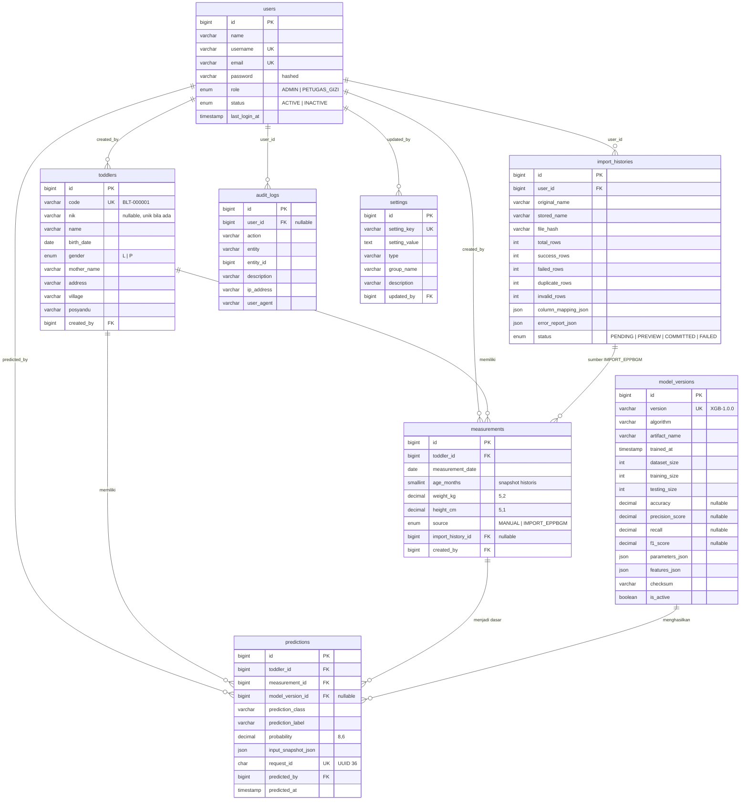

# Skema Basis Data

MySQL / MariaDB, `utf8mb4_unicode_ci`. Seluruh tabel dibuat lewat **migration**
Laravel (`web-app/database/migrations/`), tidak pernah manual.

---

## ERD



---

## Catatan Penamaan Kolom

Dua kolom dinamai berbeda dari sebutan umumnya karena nama aslinya **reserved word
MySQL**:

| Sebutan umum | Nama kolom | Alasan |
|---|---|---|
| `precision` | **`precision_score`** | `PRECISION` reserved (bagian dari `DOUBLE PRECISION`) |
| `key`, `value` | **`setting_key`**, **`setting_value`** | `KEY` reserved |

Pada `metadata.json` ML API dan pada tampilan antarmuka, metrik tetap disebut
`precision`. Pemetaannya dilakukan di `ModelVersionController::sync()`.

---

## Strategi Foreign Key

| Relasi | On Delete | Alasan |
|---|---|---|
| `measurements.toddler_id → toddlers.id` | RESTRICT | Riwayat pengukuran tidak boleh hilang diam-diam |
| `predictions.measurement_id → measurements.id` | RESTRICT | Histori prediksi wajib tetap dapat ditelusuri |
| `predictions.toddler_id → toddlers.id` | RESTRICT | Idem |
| `predictions.model_version_id → model_versions.id` | SET NULL | Model lama boleh dihapus tanpa merusak histori |
| `measurements.import_history_id → import_histories.id` | SET NULL | Batch boleh dihapus, data pengukuran tetap |
| `*.created_by`, `*.predicted_by`, `import_histories.user_id` | RESTRICT | Menjaga jejak pertanggungjawaban |
| `audit_logs.user_id → users.id` | SET NULL | Audit bertahan meski akun dihapus |
| `settings.updated_by → users.id` | SET NULL | Idem |

Seluruh foreign key benar-benar ditegakkan oleh basis data, bukan hanya di level
aplikasi. Penghapusan yang ditolak ditangani lebih dulu di service layer dengan
pesan yang jelas, sehingga pengguna tidak melihat error basis data.

---

## Indeks

| Tabel | Indeks |
|---|---|
| `users` | `username` (UK), `email` (UK), `role`, `status` |
| `toddlers` | `code` (UK), `nik`, `name`, `gender`, `village`, `posyandu`, `(village, posyandu)` |
| `measurements` | `(toddler_id, measurement_date)` (UK), `(toddler_id, measurement_date)`, `source` |
| `predictions` | `request_id` (UK), `predicted_at`, `prediction_label`, `(toddler_id, predicted_at)` |
| `model_versions` | `version` (UK), `is_active` |
| `import_histories` | `file_hash`, `status` |
| `audit_logs` | `action`, `created_at`, `(entity, entity_id)` |
| `settings` | `setting_key` (UK), `group_name` |

Batasan unik `(toddler_id, measurement_date)` mencegah satu balita memiliki dua
pemeriksaan pada tanggal yang sama, baik lewat input manual maupun import.

---

## Aturan Data Penting

### Kode balita

Format `BLT-000001`, dihitung dari **kode terbesar yang ada**, bukan dari jumlah
baris, agar penghapusan data tidak menyebabkan kode bentrok.

### `age_months` adalah snapshot

Usia dihitung dari `toddlers.birth_date` dan `measurements.measurement_date`, lalu
**disimpan**. Usia riwayat tidak pernah dihitung dari tanggal hari ini, sehingga
data lama tidak bergeser seiring waktu. Perhitungan memakai bulan penuh
(pembulatan ke bawah).

### `input_snapshot_json`

Setiap prediksi menyimpan salinan fitur yang benar-benar dipakai:

```json
{ "gender": "L", "age_months": 30, "weight_kg": 11.4, "height_cm": 86.5 }
```

Bila data pemeriksaan disunting kemudian, hasil prediksi lama tetap dapat
dipertanggungjawabkan karena masukannya tersimpan utuh.

### Kolom metrik boleh NULL

`accuracy`, `precision_score`, `recall`, `f1_score` bersifat nullable dan tetap
`NULL` sampai ada hasil training sebenarnya. Antarmuka menampilkannya sebagai `-`,
bukan `0`.

---

## Perintah Berguna

```bash
php artisan migrate                 # jalankan migrasi
php artisan migrate:fresh --seed    # ulang dari nol + data sintetis (non-production)
php artisan migrate:status
php artisan db:show --counts
```

Cadangan basis data:

```bash
mysqldump -u <user> -p sipresti > sipresti-$(date +%F).sql
```
