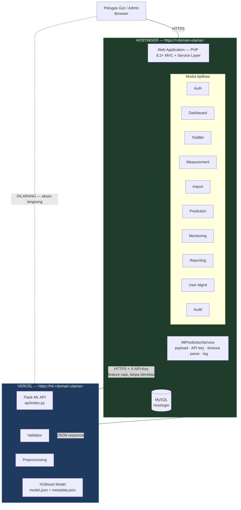
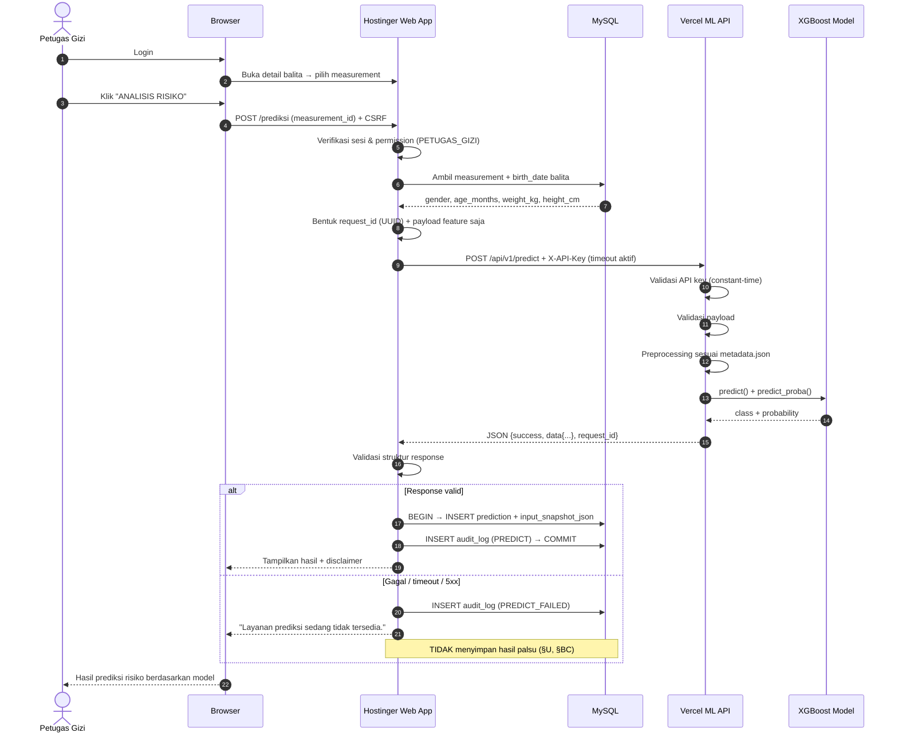
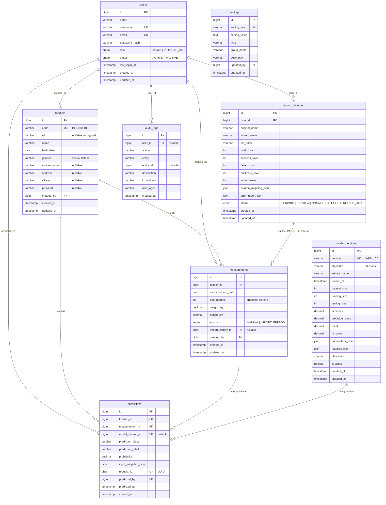
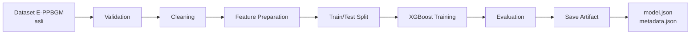
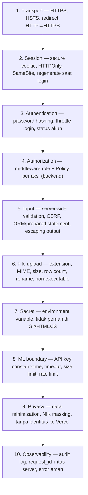
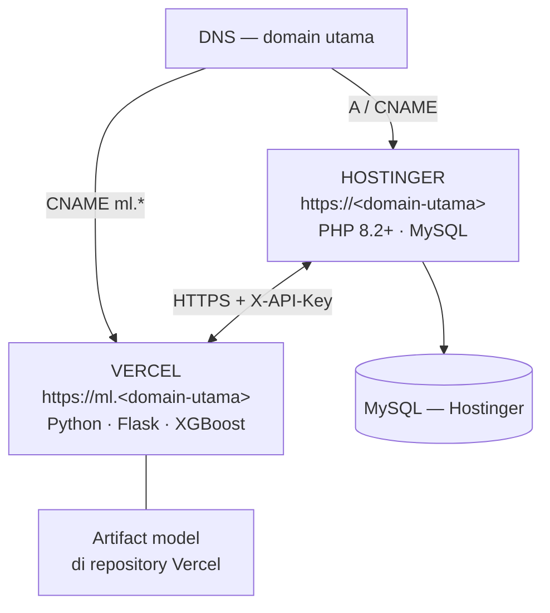

# PHASE 0 — PROJECT REQUIREMENT & ARCHITECTURE AUDIT

**Sistem**   : SIPRESTI — Sistem Prediksi Risiko Stunting, Puskesmas Lepak
**Penelitian**: "Pengembangan Web Prediksi Risiko Stunting Balita Menggunakan Algoritma XGBoost Berbasis Data E-PPBGM di Puskesmas Lepak"
**Peneliti** : Liana Sasmi Santika — NIM 220602014, Informatika, Universitas Hamzanwadi (2026)
**Tanggal**  : 26 September 2026
**Status**   : **PARTIAL** — audit lengkap, menunggu ACC + dataset E-PPBGM asli
**Aturan**   : Tidak ada kode yang ditulis pada fase ini (Master Prompt §BL)

---

## A. TUJUAN PHASE 0

Mengunci requirement, arsitektur, dan kontrak antar-komponen **sebelum** satu baris kode ditulis, serta melaporkan seluruh konflik antara skripsi, Master Prompt, dan kenyataan teknis — tanpa memilih diam-diam (Master Prompt §BB).

### Legenda penanda

| Tanda | Arti |
|---|---|
| **`[S]`** | **Dari skripsi.** Requirement penelitian. Nomor bab dicantumkan. Perubahan wajib lewat pembimbing. |
| **`[MP]`** | **Dari Master Prompt.** Keputusan arsitektur yang sudah disepakati. Mengikat. |
| **`[K]`** | **Keputusan teknis implementasi baru.** Usulan saya, belum ada di skripsi maupun Master Prompt. Butuh ACC. |
| **`[?]`** | **Belum dapat dipastikan sebelum dataset E-PPBGM diperiksa.** Tidak dikunci sekarang. |
| **`[!]`** | **Konflik / risiko** yang harus diputuskan manusia. |

### Urutan source of truth (Master Prompt §BB)

1. Skripsi penelitian → 2. Dataset E-PPBGM asli → 3. Keputusan arsitektur (Master Prompt) → 4. Source code → 5. Dokumentasi

---

## B. TEMUAN & KONFLIK — WAJIB DIPUTUSKAN SEBELUM PHASE 1

Delapan temuan. K-1 sampai K-3 memblokir pekerjaan ML. K-4 sampai K-8 memblokir penulisan naskah, bukan kode.

---

### K-1 `[!]` RISIKO DATA LEAKAGE PADA RUMUSAN MODEL — **paling kritis**

Master Prompt §Q memerintahkan saya memeriksa dan melaporkan kemungkinan data leakage. Ini hasilnya.

**Konfigurasi yang diminta:**
- Fitur `[S]` BAB I §1.3 butir 2 + `[MP]` §B: `gender`, `age_months`, `weight_kg`, `height_cm`
- Target `[S]` + `[MP]` §B: status stunting / tidak stunting

**Masalahnya:** di E-PPBGM, status stunting **bukan hasil observasi independen**. Status itu dihitung sistem secara deterministik dari **Z-score TB/U**, dan Z-score TB/U adalah fungsi matematis dari **jenis kelamin + usia + tinggi badan** — persis tiga dari empat fitur di atas.

Artinya model tidak belajar memprediksi risiko; model belajar **merekonstruksi tabel standar antropometri**. Gejala yang hampir pasti muncul saat training:

- Accuracy 99–100%, F1 ≈ 1.0
- Confusion matrix hampir tanpa kesalahan
- Feature importance didominasi `height_cm` dan `age_months`

Angka itu akan terlihat hebat di BAB IV dan **akan dipertanyakan penguji**, karena model semacam ini tidak memberi informasi baru apa pun di luar yang sudah dihitung E-PPBGM sendiri.

**Status verifikasi:** `[?]` Hipotesis ini **belum terbukti** sampai kolom label pada dataset asli diperiksa. Yang harus dicek di PHASE 1: apakah kolom label berasal dari perhitungan Z-score TB/U sistem, atau dari penetapan/validasi manual tenaga gizi.

**Tiga opsi penyelesaian:**

| Opsi | Rumusan masalah | Syarat data | Dampak ke skripsi | Nilai ilmiah |
|---|---|---|---|---|
| **A** — *disarankan* | **Prediksi prospektif**: memprediksi status pada pengukuran **berikutnya** (t+1) dari kondisi & laju pertumbuhan saat ini | Dataset **longitudinal**: ≥2–3 pengukuran per balita `[?]` | Rumusan masalah & tujuan tetap ("deteksi dini"), definisi target diperjelas di BAB III | Tinggi — benar-benar prediktif, sesuai klaim "reaktif → proaktif" (BAB III §3.3.2) |
| **B** | **Klasifikasi risiko multi-faktor**: tambah prediktor non-antropometrik (BBLR, ASI eksklusif, imunisasi, penyakit penyerta, pendidikan/usia ibu, sanitasi) | Kolom tersebut harus ada di ekspor E-PPBGM `[?]` | **Mengubah batasan masalah §1.3 butir 2** → butuh ACC pembimbing | Tinggi |
| **C** | **Otomatisasi klasifikasi status saat ini**, dibingkai jujur sebagai otomatisasi + dibandingkan baseline aturan antropometri | Cukup data cross-sectional | Tidak mengubah batasan masalah | Rendah–sedang, tetapi dapat dipertahankan bila dibingkai jujur |

**Rekomendasi:** target **A**, perkuat dengan **B** bila kolomnya tersedia, **C** sebagai jaring pengaman. Keputusan final di **PHASE 1 (audit dataset)** — tidak dikunci sekarang.

**Catatan wajib apapun opsinya:** laporkan **baseline pembanding** (aturan antropometri standar, dan/atau algoritma lain seperti Decision Tree / Random Forest / KNN sebagaimana penelitian terkait BAB II §2.1). Tanpa baseline, angka akurasi XGBoost tidak dapat ditafsirkan.

---

### K-2 `[!]` Mapping label dan encoding `gender` belum boleh ditetapkan

Master Prompt §B melarang mengasumsikan `0 = tidak stunting, 1 = stunting` sebelum dataset diperiksa. Hal yang sama berlaku untuk `gender` (`L`/`P` vs `1`/`0` vs `Laki-laki`/`Perempuan`).

**Konsekuensi desain yang sudah bisa dikunci sekarang `[K]`:**
- `metadata.json` pada artifact model **wajib** memuat `label_mapping` dan `gender_encoding` eksplisit.
- API contract mengirim `gender` sebagai **string apa adanya**; pemetaan ke numerik dilakukan di sisi ML API berdasarkan `metadata.json`, **bukan** di Hostinger.
- Kolom `predictions.prediction_class` menyimpan kelas numerik model, `prediction_label` menyimpan label manusia. Keduanya berasal dari response API, bukan diterjemahkan ulang oleh web app.

Sampai dataset diperiksa, seluruh nilai konkret pada dokumen ini yang menyangkut label ditandai `[?]`.

---

### K-3 `[!]` Ukuran paket `xgboost` vs batas bundle serverless Vercel

Master Prompt §D menetapkan Python + Flask + XGBoost di Vercel dan melarang dependency tidak perlu. Risikonya: paket `xgboost` untuk Linux berukuran besar (indikasi ratusan MB setelah ekstraksi), sementara fungsi serverless Vercel punya batas ukuran bundle. Ditambah NumPy, ada kemungkinan nyata **melewati batas**.

**Angka pastinya tidak saya klaim di sini** — wajib diukur langsung saat PHASE 8, bukan dikarang sekarang (Master Prompt §BC).

Urutan penanganan di PHASE 8:

| Langkah | Cara | Catatan |
|---|---|---|
| **1. Ukur dulu** | Build bundle dengan `xgboost` + `numpy` saja, `--no-deps` bila perlu, ukur hasilnya | Bila muat → selesai, pakai XGBoost native (§O) |
| **2. Bila melebihi batas** | Konversi artifact ke ONNX, inferensi dengan `onnxruntime` | Training **tetap** XGBoost asli; hanya runtime inferensi yang berubah, klaim penelitian tetap sah |
| **3. Bila masih bermasalah** | Traversal pohon murni NumPy dari `model.json` | Nol dependency berat, tetapi kode inferensi harus ditulis dan diuji sendiri (§AR) |
| **4. Terakhir** | Pindahkan ML API ke platform lain | **Menyimpang dari arsitektur §C** → wajib lapor & ACC, bukan diputuskan sendiri |

---

### K-4 `[!]` Skripsi menyebut SQLite; implementasi final MySQL

Master Prompt §BI sudah memutuskan MySQL dan mewajibkan perubahan ini **diberi catatan kepada peneliti, bukan disamarkan**. Berikut daftar lokasi persis di naskah yang harus disesuaikan — lihat **§14** untuk tabel lengkapnya.

Ringkasnya: SQLite muncul di **BAB I §1.3 butir 4**, **BAB III §3.4.2**, **BAB III §3.5**, dan **BAB III tabel use case nomor 6**. Sementara **BAB II §2.2.6 sudah memuat landasan teori MySQL** dan **§2.2.7 XAMPP** — jadi inkonsistensi ini **sudah ada di dalam skripsi sejak awal**, bukan diciptakan oleh keputusan arsitektur ini. Justru perubahan ke MySQL membuat BAB II dan BAB III menjadi konsisten.

---

### K-5 `[!]` Skripsi menyebut "bahasa pemrograman HTML"

BAB I §1.3 butir 4 `[S]`: *"Sistem dibangun menggunakan bahasa pemrograman HTML"*. HTML adalah bahasa markup, bukan bahasa pemrograman, dan tidak dapat menghasilkan autentikasi, otorisasi berbasis peran, maupun CRUD basis data. Master Prompt §D menetapkan **PHP 8.2+ (MVC + Service Layer)** untuk backend dan HTML5/CSS3/Bootstrap 5/JS untuk frontend.

**Usulan perbaikan naskah:** *"Sistem dibangun menggunakan bahasa pemrograman PHP dengan arsitektur MVC, antarmuka HTML5, CSS3, dan JavaScript, serta basis data MySQL. Layanan machine learning dibangun menggunakan Python."*

---

### K-6 `[!]` BAB II §2.2.4 berjudul "ALGORITMA XGBOOST" tetapi isinya bukan XGBoost

Isi §2.2.4 pada naskah berbunyi: *"Algoritma stunting adalah alur keputusan sistematis berbasis panduan Kemenkes … pemetaan hasil ukur ke grafik Z-score WHO, hingga tindakan rujukan…"*. Itu deskripsi **alur klinis penanganan stunting**, bukan deskripsi algoritma XGBoost.

Ini masalah serius: XGBoost adalah **metode inti penelitian**, dan landasan teorinya saat ini kosong. Penguji hampir pasti menanyakannya.

**Yang harus ditulis di §2.2.4:** konsep gradient boosting, ensemble pohon keputusan aditif, fungsi objektif dengan regularisasi, cara XGBoost menangani data tabular dan mencegah overfitting, serta hyperparameter utama (`n_estimators`, `max_depth`, `learning_rate`, `subsample`, `colsample_bytree`, `scale_pos_weight`). Alur klinis yang sekarang ada di §2.2.4 tetap berguna — pindahkan saja ke §2.2.2 (Stunting).

**Tambahan landasan teori yang belum ada tetapi dipakai sistem `[K]`:** PHP/Laravel, REST API, JSON, Flask, cloud deployment (Hostinger/Vercel), Confusion Matrix & metrik evaluasi, serta standar antropometri balita.

---

### K-7 `[!]` Wewenang Admin: skripsi vs Master Prompt

| Sumber | Wewenang Admin atas model |
|---|---|
| `[S]` BAB III use case 6 | *"Kelola Model XGBoost & Database"* — melakukan **pembaruan** dan konfigurasi model |
| `[MP]` §F | Admin hanya **"Melihat model aktif / informasi model / metrics model"** — tidak ada hak tulis |

**Penyebab perbedaan:** pada arsitektur final, artifact model berada di **repository Vercel**, bukan di server Hostinger. Mengunggah model lewat form web berarti menulis file ke runtime serverless — tidak mungkin, karena filesystem Vercel bersifat read-only saat runtime.

**Rekomendasi rekonsiliasi `[K]`:**
- Pembaruan model dilakukan lewat **deploy ulang repository Vercel** (proses DevOps, bukan fitur aplikasi).
- Halaman `/admin/models` bersifat **baca + satu aksi "Sinkronisasi"**, yang memanggil `GET /api/health` dan `GET /api/v1/model/info`, lalu mencatat/memperbarui baris di `model_versions`.
- Dengan begitu, use case 6 skripsi tetap terpenuhi ("mengelola dan memperbarui model") tetapi mekanismenya jujur sesuai arsitektur, dan §F tidak dilanggar.
- Naskah BAB III use case 6 disesuaikan menjadi: *"Mengelola versi model, melihat metrik model aktif, dan melakukan sinkronisasi informasi model dari ML API; pembaruan artifact model dilakukan melalui proses deployment."*

---

### K-8 `[!]` Rekomendasi intervensi gizi: dijanjikan skripsi, dibatasi Master Prompt

| Sumber | Posisi |
|---|---|
| `[S]` BAB III §3.3.2 + use case 5 | Sistem memberi *"rekomendasi tindak lanjut intervensi gizi otomatis"* |
| `[MP]` §W + §BJ | Dilarang mengarang rekomendasi medis. Boleh membangun **framework** recommendation engine, isinya harus rule/template **tervalidasi tenaga gizi** |

**Rekomendasi `[K]`:** bangun mesin rekomendasi berbasis tabel `recommendation_rules` (struktur siap, isi kosong). Sebelum aturan tervalidasi diberikan, sistem hanya menampilkan status netral:

> *"Perlu evaluasi lebih lanjut oleh Petugas Gizi."*

beserta disclaimer §BJ. Pengisian aturan dijadwalkan **PHASE 12**, dengan narasumber nutrisionis Puskesmas Lepak — dan **hasil validasinya menjadi lampiran skripsi**. Ini justru memperkuat BAB IV, bukan melemahkannya.

---

## 1. REQUIREMENT FUNGSIONAL

Prioritas: `W` = wajib v1, `S` = sebaiknya, `O` = backlog.

### 1.1 Auth Module

| ID | Requirement | Sumber | Prio |
|---|---|---|---|
| RF-01 | Login dengan username/email + password | `[S]` use case 1, `[MP]` §F | W |
| RF-02 | Logout, sesi dihentikan total | `[S]` use case 7, `[MP]` §F | W |
| RF-03 | Password di-hash, tidak pernah disimpan plaintext | `[MP]` §G, §AF | W |
| RF-04 | Rate limiting / proteksi brute-force pada login | `[MP]` §AF | W |
| RF-05 | Otorisasi diverifikasi di backend (middleware), bukan sekadar menyembunyikan tombol | `[MP]` §F | W |
| RF-06 | Status akun aktif/nonaktif; akun nonaktif ditolak login | `[MP]` §G (`users.status`) | W |
| RF-07 | Pengguna mengelola profil sendiri & ganti password | `[MP]` §F (PETUGAS_GIZI) | W |
| RF-08 | Pencatatan `last_login_at` | `[MP]` §G | W |
| RF-09 | Sesi kedaluwarsa otomatis setelah idle | `[K]` | S |

### 1.2 Toddler Module (Data Balita)

| ID | Requirement | Sumber | Prio |
|---|---|---|---|
| RF-10 | CRUD data balita | `[S]` use case 2, `[MP]` §F, §J | W |
| RF-11 | Kode internal otomatis format `BLT-000001` | `[MP]` §G | W |
| RF-12 | Daftar balita: search, pagination, filter gender | `[MP]` §J | W |
| RF-13 | Filter desa & posyandu **bila data tersedia** | `[MP]` §J, `[?]` bergantung ekspor E-PPBGM | W |
| RF-14 | Halaman detail: identitas, data terakhir, grafik pertumbuhan, histori pemeriksaan, histori prediksi | `[MP]` §J | W |
| RF-15 | Data sensitif dibatasi pada tabel daftar; NIK di-mask | `[MP]` §J, §AG | W |
| RF-16 | Hapus mengikuti policy (restrict bila punya measurement/prediction) | `[MP]` §H, §J | W |
| RF-17 | Admin hanya **melihat** data balita, tidak CRUD | `[MP]` §F | W |

### 1.3 Measurement Module (Antropometri)

| ID | Requirement | Sumber | Prio |
|---|---|---|---|
| RF-20 | Input: balita, tanggal pemeriksaan, usia bulan, berat badan, tinggi/panjang badan | `[S]` use case 2, `[MP]` §K | W |
| RF-21 | `age_months` dihitung dari `birth_date` & `measurement_date`, lalu **disimpan sebagai snapshot historis** | `[MP]` §I | W |
| RF-22 | Dilarang menghitung usia histori dari tanggal sekarang | `[MP]` §I | W |
| RF-23 | Validasi teknis: required, numeric, finite, non-negatif, format benar | `[MP]` §K | W |
| RF-24 | Batas klinis/biologis **tidak dikarang**; ditandai sebagai konfigurasi yang harus diverifikasi | `[MP]` §K, `[?]` | W |
| RF-25 | Satu balita punya banyak pemeriksaan (deret waktu) | `[MP]` §H, §G | W |
| RF-26 | `source` = `MANUAL` \| `IMPORT_EPPBGM` | `[MP]` §G | W |
| RF-27 | Deteksi *growth faltering* antar kunjungan | `[?]` butuh data longitudinal + rule tervalidasi | O |

### 1.4 Import Module (E-PPBGM)

| ID | Requirement | Sumber | Prio |
|---|---|---|---|
| RF-30 | Import berkas CSV / XLSX | `[S]` §1.3 butir 2 (data sekunder), `[MP]` §L | W |
| RF-31 | Alur wajib: Upload → Preview → Column Mapping → Validation → Error Rows → Confirmation → Transaction → Summary | `[MP]` §L | W |
| RF-32 | Nama kolom E-PPBGM **tidak diasumsikan**; pemetaan kolom dikonfigurasi pengguna | `[MP]` §L, `[?]` | W |
| RF-33 | Ringkasan hasil: jumlah row, berhasil, gagal, duplikat, invalid | `[MP]` §L | W |
| RF-34 | Menggunakan database transaction | `[MP]` §L, §AO | W |
| RF-35 | Validasi berkas: extension, MIME, size, row count; file di-rename; tidak dieksekusi | `[MP]` §AH | W |
| RF-36 | Riwayat import tersimpan di `import_histories` | `[MP]` §G | W |
| RF-37 | Template berkas import dapat diunduh | `[K]` | S |
| RF-38 | Rollback batch import | `[K]` | S |

### 1.5 Prediction Module

| ID | Requirement | Sumber | Prio |
|---|---|---|---|
| RF-40 | Menjalankan prediksi risiko stunting dengan XGBoost | `[S]` use case 3, `[MP]` §U | W |
| RF-41 | Prediksi dipicu dari measurement, tombol **"Analisis Risiko"** | `[MP]` §U, §AA | W |
| RF-42 | Browser **tidak boleh** memanggil ML API langsung; alur Browser → Hostinger → Vercel → Hostinger → MySQL → Browser | `[MP]` §C | W |
| RF-43 | Menyimpan `input_snapshot_json` berisi feature yang benar-benar dipakai saat prediksi | `[MP]` §G | W |
| RF-44 | `request_id` UUID, **UNIQUE** pada `predictions` (idempotency) | `[MP]` §V | W |
| RF-45 | Setiap prediksi menyimpan `model_version_id` | `[MP]` §AC | W |
| RF-46 | Probability berasal dari model, **bukan angka buatan** | `[MP]` §S, §BC | W |
| RF-47 | Bila ML gagal: tampilkan *"Layanan prediksi sedang tidak tersedia. Silakan coba kembali."* — **jangan simpan hasil palsu, jangan buat fallback prediction** | `[MP]` §U, §BC | W |
| RF-48 | Bila model belum ada: tampilkan status `MODEL_NOT_READY` | `[MP]` §BC | W |
| RF-49 | Prediksi batch atas hasil import | `[K]` — perluasan di luar §S minimal, butuh ACC | S |
| RF-50 | Istilah keluaran: "Prediksi Risiko Berdasarkan Model", bukan "Diagnosis Stunting"; disertai disclaimer | `[MP]` §A, §AA, §BJ | W |

### 1.6 Monitoring & Recommendation

| ID | Requirement | Sumber | Prio |
|---|---|---|---|
| RF-55 | Halaman monitoring balita | `[S]` use case 4, `[MP]` §F, §Z | W |
| RF-56 | Grafik pertumbuhan individual | `[S]` use case 4, `[MP]` §J, §AE | W |
| RF-57 | Daftar balita dengan hasil prediksi berisiko | `[MP]` §M | W |
| RF-58 | Menampilkan rekomendasi berbasis rule/template tervalidasi | `[S]` use case 5, `[MP]` §W | W |
| RF-59 | Sebelum rule tervalidasi tersedia: tampilkan status netral + disclaimer, **jangan mengarang rekomendasi medis** | `[MP]` §W, §BJ | W |
| RF-60 | Pencatatan tindakan intervensi yang benar-benar dilakukan petugas | `[K]` | O |

### 1.7 Dashboard Module

| ID | Requirement | Sumber | Prio |
|---|---|---|---|
| RF-65 | Widget: Total Balita, Total Pemeriksaan, Total Prediksi, Jumlah Berisiko, Jumlah Tidak Berisiko | `[MP]` §M | W |
| RF-66 | Visual: distribusi hasil prediksi, tren pemeriksaan, prediksi terbaru, daftar balita berisiko | `[MP]` §M | W |
| RF-67 | **Semua angka dihitung dari database**; dilarang data dummy di production | `[MP]` §M, §BC | W |
| RF-68 | Agregasi dilakukan backend; Chart.js hanya merender | `[MP]` §AE | W |

### 1.8 Reporting Module

| ID | Requirement | Sumber | Prio |
|---|---|---|---|
| RF-70 | Laporan: daftar balita, riwayat pemeriksaan, hasil prediksi, rekap per periode, statistik prediksi | `[MP]` §AD | W |
| RF-71 | Filter: tanggal awal/akhir, gender, desa, posyandu, hasil prediksi | `[MP]` §AD | W |
| RF-72 | Export PDF dan Excel/CSV, **sesuai filter yang aktif** | `[MP]` §AD | S |
| RF-73 | Pemetaan sebaran risiko per posyandu/desa | `[S]` manfaat praktis §1.4.2, `[?]` bergantung ketersediaan kolom wilayah | W |

### 1.9 User Management & Audit Module

| ID | Requirement | Sumber | Prio |
|---|---|---|---|
| RF-80 | Admin CRUD pengguna & peran | `[S]` §3.4.3, `[MP]` §F, §Z | W |
| RF-81 | Admin melihat model aktif, informasi model, metrics model | `[MP]` §F | W |
| RF-82 | Sinkronisasi info model dari ML API ke `model_versions` | `[K]` rekonsiliasi K-7 | W |
| RF-83 | Admin mengelola konfigurasi sistem (`settings`) | `[MP]` §F, §G | W |
| RF-84 | Audit log otomatis: LOGIN, LOGOUT, CREATE, UPDATE, DELETE, IMPORT, PREDICT, USER_CREATE, USER_UPDATE | `[MP]` §G, §AI | W |
| RF-85 | Audit log tidak memuat feature sensitif berlebihan pada `description` | `[MP]` §AI | W |
| RF-86 | Backup data bila tersedia di lingkungan hosting | `[MP]` §F, `[?]` bergantung kemampuan Hostinger | S |

### 1.10 Di luar lingkup v1 (ditolak secara sadar)

| Item | Alasan |
|---|---|
| Akun untuk kader posyandu | `[S]` §1.3 butir 6: sistem diperuntukkan bagi **petugas gizi**. `[MP]` §F hanya mendefinisikan 2 role |
| Aplikasi mobile native | Tidak disebut skripsi maupun Master Prompt; target adalah web responsive |
| Integrasi API langsung ke Sigizi Terpadu | Tidak ada API publik; `[S]` menetapkan **data sekunder** via ekspor berkas |
| Notifikasi WhatsApp/SMS ke orang tua | Menambah permukaan risiko privasi tanpa dasar di skripsi (§AG) |
| Multi-puskesmas / multi-tenant | `[S]` §1.3 butir 1: hanya wilayah kerja Puskesmas Lepak |
| Training model dari dalam web app | `[MP]` §N: training dan inference **dipisah**; training tidak dijalankan per-request |

---

## 2. REQUIREMENT NON-FUNGSIONAL

| ID | Kategori | Requirement & target terukur | Sumber |
|---|---|---|---|
| RNF-01 | Kinerja | Halaman daftar & dashboard tampil < 3 detik pada koneksi puskesmas | `[K]` |
| RNF-02 | Kinerja | Prediksi satuan (termasuk round-trip ke Vercel) < 3 detik p95 | `[K]` |
| RNF-03 | Kinerja | Index pada `toddlers.code`, `measurements.toddler_id`, `measurements.measurement_date`, `predictions.toddler_id`, `predictions.predicted_at`, `predictions.request_id`, `users.username`, `users.email` | `[MP]` §AP |
| RNF-04 | Kinerja | Pagination wajib; dilarang SELECT seluruh dataset untuk satu halaman | `[MP]` §AP |
| RNF-05 | Kinerja | Model di-load sekali saat inisialisasi module, tidak reload per baris | `[MP]` §AL |
| RNF-06 | Keandalan | Timeout pada panggilan ML API; kegagalan ditangani eksplisit tanpa hasil palsu | `[MP]` §T, §U |
| RNF-07 | Keandalan | Transaction pada import, penyimpanan prediksi, dan operasi bulk | `[MP]` §AO |
| RNF-08 | Keamanan | Password hashing, CSRF, XSS, SQLi, prepared statement/ORM, server-side validation, authorization middleware | `[MP]` §AF |
| RNF-09 | Keamanan | Session security: secure cookie, HTTPOnly, SameSite, HTTPS | `[MP]` §AF |
| RNF-10 | Keamanan | Secret hanya di environment variable; dilarang di Git/HTML/JS/README/source | `[MP]` §T, §AW |
| RNF-11 | Keamanan | Constant-time comparison untuk API key bila relevan | `[MP]` §T |
| RNF-12 | Keamanan | Request size limit & rate limiting pada ML API bila memungkinkan | `[MP]` §T |
| RNF-13 | Privasi | Data minimization: identitas balita **tidak pernah** dikirim ke Vercel | `[MP]` §S, §AG |
| RNF-14 | Privasi | NIK di-mask saat ditampilkan; password/API key/session token tidak pernah di-log | `[MP]` §AG, §AK |
| RNF-15 | Privasi | Data pasien nyata tidak masuk repository Git; development memakai data sintetis/anonim **yang ditandai jelas** | `[MP]` §AG, §BD |
| RNF-16 | Error handling | Production tidak menampilkan stack trace, password DB, API key, path absolut, atau detail error SQL | `[MP]` §AJ |
| RNF-17 | Logging | Log: application error, failed ML request, anomali autentikasi, kegagalan import. `request_id` menghubungkan log Hostinger ↔ Vercel | `[MP]` §AK |
| RNF-18 | Kegunaan | Seluruh antarmuka berbahasa Indonesia | `[MP]` §D |
| RNF-19 | Kegunaan | Komponen wajib: sidebar, topbar, card statistik, table responsive, modal, toast, breadcrumb, empty state, loading state, error state, confirmation dialog | `[MP]` §X |
| RNF-20 | Kegunaan | Desain profesional, bersih, sederhana; bukan template admin generik | `[MP]` §X |
| RNF-21 | Aksesibilitas | Informasi status tidak boleh bergantung warna saja — selalu ada label teks | `[MP]` §Y |
| RNF-22 | Kompatibilitas | Responsive desktop / tablet / mobile; diuji di Google Chrome | `[S]` §3.4.2, `[MP]` §X |
| RNF-23 | Akurasi model | Metrik wajib: **Accuracy, Precision, Recall, F1-score, Confusion Matrix** | `[S]` tujuan ke-3, `[MP]` §B |
| RNF-24 | Akurasi model | Ambang minimal kelayakan model | `[?]` ditetapkan setelah baseline & distribusi kelas diketahui — **tidak dikarang sekarang** |
| RNF-25 | Akurasi model | Evaluasi tidak boleh hanya berdasar accuracy | `[MP]` §R |
| RNF-26 | Reproducibility | Catat `random_state`, feature names & order, label mapping, versi library, parameter XGBoost, konfigurasi split, fingerprint dataset, timestamp, versi model | `[MP]` §P |
| RNF-27 | Traceability | Setiap prediksi dapat ditelusuri ke versi model + checksum + input snapshot | `[MP]` §G, §AB, §AC |
| RNF-28 | Versioning | Satu model production aktif pada satu waktu; dilarang overwrite tanpa versioning (`XGB-1.0.0`) | `[MP]` §AC |
| RNF-29 | Kualitas kode | Meaningful naming, small function, single responsibility, service layer, validation class, central error handler, type hints Python, strict typing PHP | `[MP]` §BE |
| RNF-30 | Kualitas kode | Hindari god controller/service, duplicate query, magic number, hardcoded secret | `[MP]` §BE |
| RNF-31 | Pengujian | Unit, Integration, API, Black Box, UAT, ML validation test | `[S]` §1.3 butir 5, `[MP]` §AQ |
| RNF-32 | Pengujian | **Dilarang menandai PASS sebelum benar-benar diuji** | `[MP]` §AQ, §BC |
| RNF-33 | Dokumentasi | README, INSTALLATION, DEPLOYMENT_HOSTINGER, DEPLOYMENT_VERCEL, API, DATABASE, ML_MODEL, TESTING, SECURITY | `[MP]` §AU |
| RNF-34 | Dokumentasi | Diagram memakai Mermaid/PlantUML agar dapat diregenerate dan tidak menyimpang dari source code | `[MP]` §AZ |
| RNF-35 | Medical safety | Dilarang diagnosis otomatis, terapi otomatis, dosis, atau rekomendasi klinis tanpa rule terverifikasi | `[MP]` §BJ |
| RNF-36 | Portabilitas | Berjalan lokal (XAMPP/Docker) maupun Hostinger tanpa ubah kode, hanya `.env` | `[K]` |
| RNF-37 | Skalabilitas | Sanggup menangani volume balita wilayah kerja Puskesmas Lepak | `[?]` jumlah balita & periode data belum diketahui |

---
## 3. ARCHITECTURE

### 3.1 Gaya arsitektur

| Komponen | Gaya | Sumber |
|---|---|---|
| Aplikasi web (Hostinger) | **Modular monolith**, MVC + Service Layer | `[MP]` §D, §E |
| ML API (Vercel) | **Service terpisah** — terpisah karena lokasi deployment, bukan karena microservices | `[MP]` §E |
| Komunikasi | **Server-to-server** HTTPS + API Key | `[MP]` §C, §T, §U |

Master Prompt §E melarang microservices berlebihan. ML API adalah **satu-satunya** service terpisah, dan itu konsekuensi hosting (Python tidak berjalan di shared hosting PHP), bukan keputusan gaya arsitektur.

### 3.2 Diagram arsitektur



**Aturan mengikat `[MP]` §C:** browser **tidak boleh** memanggil Vercel ML API secara langsung. Alasannya: API key tidak terekspos, logging terpusat, validasi server-side, dan pengguna tidak dapat memanipulasi endpoint ML.

### 3.3 Pembagian tanggung jawab Hostinger ↔ Vercel

| Tanggung jawab | Hostinger | Vercel |
|---|---|---|
| Autentikasi & otorisasi | ✅ | ❌ |
| Penyimpanan data balita & identitas | ✅ | ❌ **tidak pernah** |
| Validasi bisnis & permission | ✅ | ❌ |
| Pembuatan `request_id` UUID | ✅ | ❌ |
| Validasi payload teknis | ✅ (sebelum kirim) | ✅ (defensif, §S) |
| Preprocessing feature | ❌ | ✅ |
| Inferensi XGBoost & probability | ❌ | ✅ |
| Penyimpanan hasil prediksi | ✅ | ❌ **stateless** |
| Audit log | ✅ | ❌ |
| Agregasi dashboard & laporan | ✅ | ❌ |
| Penyimpanan artifact model | ❌ | ✅ (di repository) |

Vercel bersifat **stateless**: tidak punya database, tidak menyimpan apa pun antar-request.

### 3.4 Data flow prediction `[MP]` §U, §BA



### 3.5 Lapisan aplikasi Hostinger

```
Request
  → Route
  → Middleware (auth, role, CSRF, throttle)
  → Controller        ← tipis; tanpa logika HTTP ke ML (§AN)
  → FormRequest/Validator
  → Service Layer     ← MlPredictionService, ImportService, PredictionService
  → Repository/Model  ← Eloquent / PDO prepared statement
  → MySQL
```

---

## 4. MODULE MAP

Sepuluh modul aplikasi `[MP]` §E, ditambah satu service khusus `[MP]` §AN.

| # | Modul | Tanggung jawab | Bergantung pada | Role |
|---|---|---|---|---|
| 1 | **Auth** | Login, logout, sesi, password hashing, throttle, profil sendiri | — | Semua |
| 2 | **Dashboard** | Agregasi statistik dari database nyata, widget, chart | Toddler, Measurement, Prediction | Semua |
| 3 | **Toddler** | CRUD balita, kode `BLT-xxxxxx`, search/filter, halaman detail | Auth | PETUGAS_GIZI (tulis), ADMIN (baca) |
| 4 | **Measurement** | CRUD antropometri, snapshot `age_months`, validasi | Toddler | PETUGAS_GIZI (tulis), ADMIN (baca) |
| 5 | **Import** | Upload → preview → mapping → validasi → transaksi → summary | Toddler, Measurement | PETUGAS_GIZI |
| 6 | **Prediction** | Orkestrasi prediksi, idempotency, persistensi, histori | Measurement, **MlPredictionService**, Audit | PETUGAS_GIZI (jalankan), ADMIN (baca) |
| 7 | **Monitoring** | Pemantauan balita, grafik pertumbuhan, daftar berisiko, rekomendasi | Prediction, Measurement | PETUGAS_GIZI |
| 8 | **Reporting** | Laporan berfilter, rekap periode, statistik, export PDF/Excel | Semua modul data | PETUGAS_GIZI |
| 9 | **User Management** | CRUD pengguna & role, settings, info & metrics model | Auth | ADMIN |
| 10 | **Audit** | Pencatatan otomatis aksi, penelusuran `request_id` | Semua modul | ADMIN (baca) |
| — | **MlPredictionService** | Build payload, API key, timeout, call, parse, error handling, structured log | Prediction | internal |

**Aturan `[MP]` §AN:** seluruh logika HTTP ke ML API terkurung di `MlPredictionService`. Controller dilarang memuat logika request HTTP.

### 4.1 Struktur direktori

**Hostinger — bila Laravel `[MP]` §AM:**
```
app/
  Http/{Controllers,Middleware,Requests}/
  Models/          # User, Toddler, Measurement, Prediction, ModelVersion, ImportHistory, AuditLog, Setting
  Services/        # MlPredictionService, PredictionService, ImportService, ReportService, DashboardService
  Repositories/
  Policies/        # ToddlerPolicy, MeasurementPolicy, PredictionPolicy, UserPolicy
resources/views/{layouts,auth,dashboard,balita,pemeriksaan,prediksi,monitoring,laporan,admin}/
resources/{js,css}/
database/{migrations,seeders}/
routes/web.php
docs/
```

**Bila hosting tidak cocok untuk Laravel — PHP MVC modular `[MP]` §D, §AM:**
```
app/{Controllers,Models,Services,Repositories,Middleware,Views}/
config/  public/  routes/  storage/
```
`[MP]` §D: bila jalur ini diambil, **database dan API contract tidak berubah**. Dilarang menaruh seluruh aplikasi dalam satu `index.php`.

**Vercel `[MP]` §AL:**
```
stunting-ml-api/
  api/index.py
  ml/{predictor.py,validator.py,preprocessing.py}
  models/{xgboost_model.json,metadata.json,preprocessor.joblib?}
  tests/
  requirements.txt  vercel.json  .env.example  .gitignore  README.md
```

---

## 5. ERD

### 5.1 Diagram



### 5.2 Tabel opsional — `recommendation_rules` `[K]` `[?]`

Struktur disiapkan, **isi kosong** sampai rule tervalidasi nutrisionis tersedia (§W, K-8):

| Kolom | Tipe | Keterangan |
|---|---|---|
| `id` | bigint PK | |
| `code` | varchar UK | kode rule |
| `prediction_class` | varchar | kelas prediksi pemicu `[?]` mengikuti dataset |
| `condition_json` | json | syarat tambahan (usia, gender) |
| `title`, `content` | varchar/text | isi rekomendasi **tervalidasi** |
| `source_reference` | varchar | sumber pedoman resmi |
| `validated_by`, `validated_at` | varchar/timestamp | jejak validasi → lampiran skripsi |
| `is_active` | boolean | |

### 5.3 Catatan teknis skema `[!]` `[K]`

| Isu | Penjelasan | Usulan |
|---|---|---|
| Kolom `precision` | `PRECISION` adalah **reserved word MySQL** (bagian dari `DOUBLE PRECISION`). Memakainya menuntut backtick di setiap query dan rawan error. Master Prompt §G menyebut field `precision`. | Gunakan **`precision_score`** di database; tetap bernama `precision` pada `metadata.json` dan tampilan UI. **Butuh ACC.** |
| Kolom `key` / `value` pada `settings` | `KEY` reserved word MySQL | Gunakan `setting_key`, `setting_value`, `group_name`. **Butuh ACC.** |
| `import_history_id` pada `measurements` | Tidak ada di §G, tetapi tanpa ini rollback batch import (RF-38) dan penelusuran asal data mustahil | Tambahkan sebagai kolom nullable `[K]` |
| Tipe `prediction_class` | Bisa integer (0/1) atau string multi-kelas | Disimpan `varchar` agar aman terhadap hasil audit dataset `[?]` |
| Enkripsi `nik` | §AG mewajibkan data minimization & masking | Enkripsi di level aplikasi; jangan dijadikan index pencarian utama |
| `predictions.request_id` | §V mewajibkan UNIQUE | `CHAR(36)` + UNIQUE INDEX |

### 5.4 Strategi foreign key & index `[MP]` §H, §AP

| Relasi | On Delete | Alasan |
|---|---|---|
| `measurements.toddler_id → toddlers.id` | **RESTRICT** | Riwayat pengukuran tidak boleh hilang diam-diam |
| `predictions.measurement_id → measurements.id` | **RESTRICT** | Histori prediksi wajib tetap dapat ditelusuri (§AB) |
| `predictions.model_version_id → model_versions.id` | **SET NULL** | Model lama boleh dihapus tanpa merusak histori |
| `predictions.toddler_id → toddlers.id` | **RESTRICT** | Idem |
| `*.created_by / predicted_by / user_id → users.id` | **RESTRICT** | Jejak pertanggungjawaban |
| `audit_logs.user_id → users.id` | **SET NULL** | Audit bertahan meski akun dihapus |

**Index wajib:** `toddlers.code` (UK), `toddlers.nik`, `toddlers.name`, `measurements(toddler_id, measurement_date)`, `predictions.toddler_id`, `predictions.predicted_at`, `predictions.request_id` (UK), `users.username` (UK), `users.email` (UK), `audit_logs(entity, entity_id)`, `audit_logs.created_at`.

**`[MP]` §G:** seluruh tabel dibuat lewat **migration**, bukan manual. Foreign key benar-benar ditegakkan, bukan FK palsu.

---

## 6. ROLE & PERMISSION MATRIX

Dua role `[S]` §3.4.3 + `[MP]` §F: **ADMIN**, **PETUGAS_GIZI**.

| # | Kapabilitas | ADMIN | PETUGAS_GIZI | Sumber |
|---|---|:---:|:---:|---|
| 1 | Login / Logout | ✅ | ✅ | `[S]` uc 1,7 · `[MP]` §F |
| 2 | Dashboard | ✅ | ✅ | `[MP]` §F |
| 3 | Lihat data balita | ✅ | ✅ | `[MP]` §F |
| 4 | Tambah / ubah / hapus balita | ❌ | ✅ | `[MP]` §F |
| 5 | Lihat data pengukuran | ✅ | ✅ | `[MP]` §F |
| 6 | Tambah / ubah / hapus pengukuran | ❌ | ✅ | `[MP]` §F |
| 7 | Import data E-PPBGM | ❌ | ✅ | `[MP]` §F |
| 8 | **Menjalankan prediksi** | ❌ | ✅ | `[MP]` §F |
| 9 | Lihat hasil & histori prediksi | ✅ | ✅ | `[MP]` §F |
| 10 | Monitoring & visualisasi | ❌ | ✅ | `[MP]` §F |
| 11 | Laporan & export | ❌ | ✅ | `[MP]` §F |
| 12 | Lihat rekomendasi | ❌ | ✅ | `[MP]` §F |
| 13 | Kelola pengguna | ✅ | ❌ | `[MP]` §F |
| 14 | Lihat model aktif & informasi model | ✅ | ❌ | `[MP]` §F |
| 15 | Lihat metrics model | ✅ | ❌ | `[MP]` §F |
| 16 | Sinkronisasi info model dari ML API | ✅ | ❌ | `[K]` rekonsiliasi K-7 |
| 17 | Kelola konfigurasi sistem | ✅ | ❌ | `[MP]` §F |
| 18 | Lihat audit log | ✅ | ❌ | `[MP]` §F |
| 19 | Backup data bila tersedia | ✅ | ❌ | `[MP]` §F · `[?]` |
| 20 | Kelola profil sendiri | ✅ | ✅ | `[MP]` §F |

### 6.1 Konsekuensi desain

- **Admin sengaja tidak punya hak tulis atas data klinis.** Ini pemisahan tugas yang benar: pengelola sistem bukan pengelola data pasien. Pada BAB III, use case "Kelola Data Antropometri" tetap milik Petugas Gizi — sudah sesuai skripsi `[S]`.
- **Admin tidak dapat menjalankan prediksi.** Sesuai §F. Skripsi juga menempatkan use case 3 pada Petugas Gizi `[S]`.
- **Penegakan di backend `[MP]` §F:** setiap route dilindungi middleware role; setiap aksi domain dilindungi Policy. Menyembunyikan tombol di frontend **tidak dihitung** sebagai otorisasi.
- **Uji otorisasi wajib masuk skenario Black Box** (§AQ: "Role authorization").

---

## 7. ROUTE MAP

Sesuai `[MP]` §Z. Kolom **Guard** menyebut middleware yang wajib.

### 7.1 Public / Auth

| Method | Route | Aksi | Guard |
|---|---|---|---|
| GET | `/` | Redirect ke `/login` atau `/dashboard` | — |
| GET | `/login` | Form login | `guest` |
| POST | `/login` | Proses login | `guest`, `throttle`, CSRF |
| POST | `/logout` | Logout | `auth`, CSRF |

### 7.2 Petugas Gizi

| Method | Route | Aksi | Guard |
|---|---|---|---|
| GET | `/dashboard` | Dashboard | `auth` |
| GET | `/balita` | Daftar balita (search, pagination, filter) | `auth` |
| GET | `/balita/create` | Form tambah | `auth`, `role:PETUGAS_GIZI` |
| POST | `/balita` | Simpan | `auth`, `role:PETUGAS_GIZI`, CSRF |
| GET | `/balita/{id}` | Detail + grafik + histori | `auth` |
| GET | `/balita/{id}/edit` | Form ubah | `auth`, `role:PETUGAS_GIZI` |
| PUT | `/balita/{id}` | Perbarui | `auth`, `role:PETUGAS_GIZI`, CSRF |
| DELETE | `/balita/{id}` | Hapus sesuai policy | `auth`, `role:PETUGAS_GIZI`, CSRF |
| GET | `/pemeriksaan` | Daftar pemeriksaan | `auth` |
| GET | `/pemeriksaan/create` | Form tambah | `auth`, `role:PETUGAS_GIZI` |
| POST | `/pemeriksaan` | Simpan | `auth`, `role:PETUGAS_GIZI`, CSRF |
| GET | `/pemeriksaan/{id}` | Detail + tombol Analisis Risiko | `auth` |
| PUT | `/pemeriksaan/{id}` | Perbarui | `auth`, `role:PETUGAS_GIZI`, CSRF |
| DELETE | `/pemeriksaan/{id}` | Hapus sesuai policy | `auth`, `role:PETUGAS_GIZI`, CSRF |
| GET | `/import` | Halaman import | `auth`, `role:PETUGAS_GIZI` |
| POST | `/import/upload` | Upload + preview | `auth`, `role:PETUGAS_GIZI`, CSRF |
| POST | `/import/mapping` | Simpan column mapping + validasi | `auth`, `role:PETUGAS_GIZI`, CSRF |
| POST | `/import/commit` | Eksekusi dalam transaction | `auth`, `role:PETUGAS_GIZI`, CSRF |
| GET | `/import/{id}` | Ringkasan hasil import | `auth`, `role:PETUGAS_GIZI` |
| GET | `/prediksi` | Histori prediksi | `auth` |
| POST | `/prediksi` | **Jalankan Analisis Risiko** | `auth`, `role:PETUGAS_GIZI`, CSRF, `throttle` |
| GET | `/prediksi/{id}` | Detail hasil prediksi | `auth` |
| GET | `/monitoring` | Monitoring & daftar berisiko | `auth`, `role:PETUGAS_GIZI` |
| GET | `/laporan` | Laporan berfilter | `auth`, `role:PETUGAS_GIZI` |
| GET | `/laporan/export` | Export PDF / Excel sesuai filter | `auth`, `role:PETUGAS_GIZI` |
| GET | `/profil` | Profil sendiri | `auth` |
| PUT | `/profil` | Perbarui profil / password | `auth`, CSRF |

### 7.3 Admin

| Method | Route | Aksi | Guard |
|---|---|---|---|
| GET | `/admin/users` | Daftar pengguna | `auth`, `role:ADMIN` |
| GET | `/admin/users/create` | Form tambah | `auth`, `role:ADMIN` |
| POST | `/admin/users` | Simpan | `auth`, `role:ADMIN`, CSRF |
| GET | `/admin/users/{id}/edit` | Form ubah | `auth`, `role:ADMIN` |
| PUT | `/admin/users/{id}` | Perbarui | `auth`, `role:ADMIN`, CSRF |
| DELETE | `/admin/users/{id}` | Nonaktifkan / hapus | `auth`, `role:ADMIN`, CSRF |
| GET | `/admin/models` | Daftar versi model | `auth`, `role:ADMIN` |
| POST | `/admin/models/sync` | Sinkronisasi dari ML API `[K]` | `auth`, `role:ADMIN`, CSRF |
| GET | `/admin/model-metrics` | Metrics model | `auth`, `role:ADMIN` |
| GET | `/admin/audit-logs` | Audit log berfilter | `auth`, `role:ADMIN` |
| GET | `/admin/settings` | Konfigurasi sistem | `auth`, `role:ADMIN` |
| PUT | `/admin/settings` | Simpan konfigurasi | `auth`, `role:ADMIN`, CSRF |

### 7.4 Endpoint internal (AJAX, dipanggil halaman sendiri)

| Method | Route | Aksi | Guard |
|---|---|---|---|
| GET | `/api/internal/dashboard/stats` | Data widget & chart | `auth`, same-origin |
| GET | `/api/internal/toddlers/{id}/growth` | Seri data grafik pertumbuhan | `auth`, same-origin |
| GET | `/api/internal/ml/health` | Status ML API untuk indikator UI | `auth`, `role:ADMIN` |

**Catatan:** tidak ada route publik yang meneruskan permintaan ke Vercel. Seluruh panggilan ML berasal dari proses server-side `/prediksi` (`[MP]` §C).

---

## 8. API CONTRACT — HOSTINGER → VERCEL

Basis: `[MP]` §S, §T, §U, §V. Base URL: `https://ml.<domain-utama>` `[?]` domain final belum ditetapkan.

### 8.1 Autentikasi & header

| Header | Wajib | Keterangan |
|---|---|---|
| `Content-Type: application/json` | ✅ | `[MP]` §S |
| `X-API-Key: <SECRET>` | ✅ | Dari env `ML_API_KEY`. Dibandingkan **constant-time** di sisi Vercel (§T) |
| `User-Agent: SIPRESTI-Hostinger/1.0` | `[K]` | Memudahkan penelusuran log |

Timeout sisi Hostinger: dari env `ML_API_TIMEOUT` (§AV). Nilai awal usulan **10 detik** `[K]`.

### 8.2 `GET /api/health`

Response `200`:
```json
{
  "success": true,
  "service": "stunting-ml-api",
  "model_loaded": true,
  "model_version": "XGB-1.0.0"
}
```
Bila model gagal dimuat → `503` dengan `"model_loaded": false`.
**Dilarang** menampilkan secret atau path internal (`[MP]` §S).

### 8.3 `GET /api/v1/model/info` `[K]`

Perluasan di luar endpoint minimal §S, diperlukan untuk RF-82 (sinkronisasi `model_versions`). **Butuh ACC.**

```json
{
  "success": true,
  "data": {
    "model_version": "XGB-1.0.0",
    "algorithm": "XGBoost",
    "features": ["gender", "age_months", "weight_kg", "height_cm"],
    "label_mapping": { "...": "..." },
    "trained_at": "...",
    "checksum": "sha256:...",
    "metrics": {
      "accuracy": null, "precision": null, "recall": null, "f1_score": null
    }
  }
}
```
Nilai `metrics` di atas sengaja `null` — akan terisi **hanya** dari hasil training sebenarnya (`[MP]` §BC). `label_mapping` menunggu audit dataset `[?]`.

### 8.4 `POST /api/v1/predict`

**Request** (`[MP]` §S — hanya feature, tanpa identitas):
```json
{
  "request_id": "550e8400-e29b-41d4-a716-446655440000",
  "gender": "<sesuai encoding dataset>",
  "age_months": 24,
  "weight_kg": 9.2,
  "height_cm": 79
}
```

> `[?]` Nilai `gender` **belum ditetapkan**. Master Prompt §B melarang asumsi sebelum dataset diperiksa. Pemetaan ke numerik dilakukan di sisi ML API berdasarkan `metadata.json`.

**Dilarang keras dikirim** (`[MP]` §S, §AG): `name`, `nik`, `mother_name`, `address`, `village`, `posyandu`, nomor telepon, `toddler_id`, `code`.

**Response sukses `200`:**
```json
{
  "success": true,
  "request_id": "550e8400-e29b-41d4-a716-446655440000",
  "data": {
    "prediction_class": "<kelas dari model>",
    "prediction_label": "<label sesuai label_mapping>",
    "probability": 0.0000,
    "model_version": "XGB-1.0.0"
  }
}
```
`probability` **wajib** berasal dari `predict_proba()` model, rentang 0..1 (`[MP]` §S, §AR, §BC).

**Response error:**
```json
{
  "success": false,
  "request_id": "550e8400-e29b-41d4-a716-446655440000",
  "error": { "code": "VALIDATION_ERROR", "message": "..." }
}
```

### 8.5 Tabel kode error `[MP]` §S

| HTTP | `error.code` | Penyebab | Perlakuan Hostinger |
|---|---|---|---|
| `200` | — | Sukses | Simpan prediction + audit log |
| `400` | `BAD_REQUEST` | JSON tidak valid / field wajib hilang | Log, tampilkan error umum, jangan simpan |
| `401` | `UNAUTHORIZED` | `X-API-Key` salah/kosong | **Alarm keamanan**, log, jangan retry |
| `422` | `VALIDATION_ERROR` | Tipe salah, nilai non-finite, negatif, di luar rentang | Log + tampilkan pesan validasi |
| `429` | `RATE_LIMITED` | Melebihi batas | Backoff, pesan "coba kembali" |
| `500` | `INTERNAL_ERROR` | Kesalahan tak terduga | Log, pesan umum, detail hanya ke server log (§AJ) |
| `503` | `MODEL_NOT_READY` | Model belum dimuat / belum tersedia | Tampilkan status development yang benar (§BC) |
| — | `TIMEOUT` (sisi klien) | Melebihi `ML_API_TIMEOUT` | Pesan *"Layanan prediksi sedang tidak tersedia."* |

**Pada seluruh kondisi gagal: dilarang menyimpan hasil prediksi palsu** (`[MP]` §U, §BC).

### 8.6 Idempotency `[MP]` §V

- `request_id` UUID dibuat **di Hostinger**, sebelum request dikirim.
- Kolom `predictions.request_id` **UNIQUE**.
- Bila retry jaringan menyebabkan request yang sama terkirim ulang dan response sukses tiba dua kali, insert kedua ditolak constraint → ditangani sebagai "sudah tersimpan", bukan error ke pengguna.
- `request_id` yang sama dicatat pada log Hostinger **dan** Vercel agar satu transaksi dapat ditelusuri lintas-server (`[MP]` §AK).

### 8.7 `POST /api/v1/predict/batch` `[K]` — usulan, butuh ACC

Tidak ada di §S. Diperlukan bila RF-49 (prediksi massal hasil import) disetujui. Usulan: maksimum **200 instance** per request, masing-masing dengan `ref` pseudonim (bukan identitas), response berisi array hasil dengan `request_id` induk + `ref` per baris. **Jangan diimplementasikan sebelum di-ACC.**

### 8.8 Kontrak yang mengikat kedua sisi

| Aturan | Konsekuensi |
|---|---|
| Urutan & nama feature mengikuti `metadata.json` | Perubahan feature = versi model baru (§AC) |
| Hostinger tidak menerjemahkan ulang label | `prediction_label` diambil apa adanya dari response |
| Vercel stateless | Tidak menyimpan request/response apa pun |
| Vercel tidak menerima identitas | Diverifikasi lewat API test (§AQ) |
| Perubahan contract = perubahan versi API | Path `/api/v1/` dipertahankan; perubahan breaking → `/api/v2/` |

---
## 9. ML PIPELINE

Prinsip utama `[MP]` §N: **training dan inference dipisah total**. Training tidak pernah dijalankan saat pengguna menekan "Analisis Risiko".

### 9.1 Pipeline training (offline, lokal — tidak di-deploy ke Vercel)



| Tahap | Isi | Catatan |
|---|---|---|
| **0. Akuisisi** | Ekspor E-PPBGM + surat izin penelitian | Prasyarat `[?]`; data asli **tidak masuk Git** (§AG, §AW) |
| **1. Validation** | Profiling: jumlah baris, tipe, missing, duplikat, rentang nilai, distribusi label | Output: laporan audit dataset PHASE 1 |
| **2. Cleaning** | Duplikat, nilai mustahil, missing | **Threshold biologis tidak dikarang** (§K) — pakai pedoman resmi yang diberikan pengguna atau rentang yang terbaca dari data, dan tandai sebagai konfigurasi yang harus diverifikasi |
| **3. Feature Preparation** | Encoding `gender` sesuai dataset, penyelarasan `age_months` | Encoding **didokumentasikan** di `metadata.json` (§B) |
| **4. Leakage check** | Uji K-1: apakah label deterministik terhadap feature | **Wajib dilaporkan** (§Q). Bila terbukti → pilih opsi A/B/C |
| **5. Split** | Train/test dengan `random_state` tercatat | **Bila data longitudinal**, split harus **per balita (group split)**, bukan per baris — kalau tidak, pengukuran anak yang sama bocor ke train dan test `[K]` |
| **6. Imbalance** | Periksa distribusi label **lebih dulu** | §R: **jangan** otomatis SMOTE/ADASYN/`scale_pos_weight`. Bila dipakai, jelaskan alasannya |
| **7. Training** | XGBoost, parameter tercatat | `[MP]` §B |
| **8. Tuning** | Grid Search / Random Search | `[S]` BAB I latar belakang menyebut perbandingan keduanya — opsional, bila waktu memungkinkan |
| **9. Evaluation** | **Accuracy, Precision, Recall, F1, Confusion Matrix** | `[S]` tujuan ke-3, `[MP]` §B. §R: jangan hanya accuracy |
| **10. Baseline** | Bandingkan dengan algoritma lain (Decision Tree / RF / KNN) | `[S]` BAB II §2.1 mengutip penelitian pembanding — memperkuat BAB IV `[K]` |
| **11. Save artifact** | `model.json` (native XGBoost, §O) + `metadata.json` | `preprocessor.joblib` **hanya bila** ada objek preprocessing yang harus dipertahankan (§O) |

### 9.2 Pipeline inference (runtime, di Vercel)


`[MP]` §AL: model di-load **sekali** pada inisialisasi module, bukan per baris.

### 9.3 `metadata.json` `[MP]` §O, §P

```json
{
  "version": "XGB-1.0.0",
  "algorithm": "XGBoost",
  "features": ["gender", "age_months", "weight_kg", "height_cm"],
  "feature_order": ["gender", "age_months", "weight_kg", "height_cm"],
  "gender_encoding": {},
  "label_mapping": {},
  "trained_at": "",
  "random_state": null,
  "dataset_fingerprint": "",
  "library_versions": { "xgboost": "", "numpy": "", "scikit-learn": "" },
  "parameters": {},
  "split": { "dataset_size": null, "training_size": null, "testing_size": null },
  "metrics": { "accuracy": null, "precision": null, "recall": null, "f1_score": null },
  "confusion_matrix": null
}
```

**Seluruh nilai di atas kosong/null dengan sengaja.** Akan terisi **hanya** dari training sebenarnya (`[MP]` §BC: dilarang mengarang accuracy 95%, precision 96%, dan seterusnya).

### 9.4 Reproducibility `[MP]` §P

Wajib dicatat dan disimpan bersama artifact: `random_state`, feature names & order, label mapping, versi library, parameter XGBoost, konfigurasi train/test, fingerprint/checksum dataset, timestamp training, versi model, serta `requirements-training.txt` terpisah dari `requirements.txt` Vercel.

### 9.5 ML testing `[MP]` §AR

| Test | Kriteria lulus |
|---|---|
| Model dapat di-load | Tanpa exception saat init |
| Jumlah feature benar | Sesuai `metadata.features` |
| Urutan feature benar | Salah urutan → prediksi salah diam-diam. Diuji eksplisit |
| Preprocessing konsisten | Input sama → output sama |
| Prediction valid | Kelas ada dalam `label_mapping` |
| Probability 0..1 | Di luar rentang → gagal |
| Missing feature ditolak | `422 VALIDATION_ERROR` |
| Invalid numeric ditolak | NaN/Inf/negatif/string → `422` |
| Model version tersedia | `/api/health` mengembalikan versi |
| Smoke test otomatis | Dijalankan setelah setiap deploy |

### 9.6 Batas tegas `[MP]` §BC, §BD

- Metrik dummy **dilarang** masuk `model_versions`, `metadata.json`, dokumentasi, maupun BAB IV.
- Selama model belum ada: sistem menampilkan `MODEL_NOT_READY`, bukan angka contoh.
- Struktur dataset final **tidak diasumsikan**. Boleh dibuat importer interface, sample schema, dan data sintetis — dengan penandaan jelas **`DEVELOPMENT / SYNTHETIC DATA`**.

---

## 10. SECURITY ARCHITECTURE

### 10.1 Lapisan pertahanan



### 10.2 Kontrol per ancaman

| Ancaman | Kontrol | Sumber |
|---|---|---|
| Pencurian kredensial | Password hashing, throttle login, proteksi brute-force, `status` akun | `[MP]` §AF |
| Pembajakan sesi | Secure + HTTPOnly + SameSite cookie, HTTPS, regenerasi session id saat login | `[MP]` §AF |
| Akses lintas-role | Middleware role + Policy; **verifikasi di backend**, bukan sembunyikan tombol | `[MP]` §F |
| SQL Injection | ORM / prepared statement, tanpa konkatenasi query | `[MP]` §AF |
| XSS | Escaping output Blade/template, validasi input | `[MP]` §AF |
| CSRF | Token CSRF pada seluruh POST/PUT/DELETE | `[MP]` §AF |
| Upload berbahaya | Batas extension/MIME/size/row, rename file, simpan di lokasi non-executable, hapus temporary | `[MP]` §AH |
| Kebocoran API key | Hanya di env var; dilarang di Git, HTML, JS frontend, README, source | `[MP]` §T, §AW |
| Penyalahgunaan ML endpoint | API key wajib, constant-time compare, rate limit, input size limit, timeout | `[MP]` §T |
| Browser memanggil Vercel langsung | Dilarang arsitektural; tidak ada endpoint proxy publik | `[MP]` §C |
| Kebocoran data pasien | Data minimization, tanpa identitas ke Vercel, NIK masking, data nyata tidak di Git | `[MP]` §AG |
| Kebocoran informasi lewat error | Production tanpa stack trace / path / SQL error / kredensial | `[MP]` §AJ |
| Kebocoran lewat log | Password, API key, session token tidak pernah di-log | `[MP]` §AK |
| Penyangkalan aksi | Audit log otomatis: LOGIN, LOGOUT, CREATE, UPDATE, DELETE, IMPORT, PREDICT, USER_CREATE, USER_UPDATE | `[MP]` §G, §AI |
| Duplikasi akibat retry | `request_id` UUID UNIQUE | `[MP]` §V |
| Korupsi data saat operasi kritis | Database transaction pada import, persistensi prediksi, bulk | `[MP]` §AO |

### 10.3 Pengelolaan secret `[MP]` §T, §AV, §AW

| Lokasi | Variabel |
|---|---|
| **Hostinger** | `APP_ENV`, `APP_KEY`, `APP_URL`, `DB_HOST`, `DB_PORT`, `DB_DATABASE`, `DB_USERNAME`, `DB_PASSWORD`, `ML_API_URL`, `ML_API_KEY`, `ML_API_TIMEOUT` |
| **Vercel** | `ML_API_KEY`, `MODEL_PATH`, `APP_ENV` |
| **Repository** | `.env.example` saja — tanpa nilai nyata |

`.gitignore` wajib memuat: `.env`, `*.sqlite`, dump database pribadi, folder upload, temporary file, `venv`, `__pycache__`, `node_modules`, `vendor` (sesuai workflow), dan **dataset pasien nyata** (`[MP]` §AW).

### 10.4 Medical safety `[MP]` §A, §BJ, §Y

- Sistem adalah **Decision Support System**, bukan sistem diagnosis medis otomatis.
- Istilah yang dipakai: *"Prediksi Risiko Berdasarkan Model"*, *"Indikasi Berdasarkan Model"*, *"Perlu Evaluasi Petugas Gizi"*. **Dilarang**: *"Diagnosis Stunting"*.
- `probability` ditampilkan sebagai *"Probabilitas keluaran model"*, **bukan** *"tingkat kepastian medis"*.
- Disclaimer wajib pada setiap hasil prediksi:
  > *"Hasil prediksi merupakan alat bantu pendukung keputusan dan tidak menggantikan pemeriksaan serta penilaian tenaga kesehatan."*
- Warna tidak pernah menjadi satu-satunya pembawa informasi status — selalu disertai label teks (§Y).
- Dilarang: diagnosis otomatis, terapi otomatis, perhitungan dosis, rekomendasi klinis tanpa rule terverifikasi.

---

## 11. DEPLOYMENT ARCHITECTURE

### 11.1 Topologi `[MP]` §AX



| Komponen | Platform | Isi |
|---|---|---|
| Web application | Hostinger | PHP 8.2+, MVC + Service Layer |
| Database | Hostinger | MySQL / MariaDB `[MP]` §C |
| ML API | Vercel | Python + Flask + XGBoost |
| Domain utama | `[?]` | Belum ditetapkan |
| Subdomain ML | `ml.<domain-utama>` | CNAME ke Vercel |

### 11.2 Verifikasi lingkungan Hostinger — WAJIB sebelum memilih Laravel `[MP]` §D

| Yang diperiksa | Mengapa penting |
|---|---|
| Versi PHP | Harus 8.2+ |
| Composer tersedia | Tanpa ini, Laravel harus di-upload beserta `vendor/` |
| Akses SSH | Menentukan cara menjalankan migration & artisan |
| Document root | Laravel mengarahkan ke `public/`, bukan root akun |
| Permission `storage/` & `bootstrap/cache/` | Aplikasi gagal total bila tidak writable |
| Dukungan cron | Bila nanti dibutuhkan scheduler |
| Batas `upload_max_filesize` & `max_execution_time` | Menentukan batas aman import E-PPBGM |

**Bila hasil verifikasi menunjukkan Laravel tidak layak** → pakai PHP MVC modular, **tanpa mengubah database maupun API contract** (`[MP]` §D). Verifikasi ini dijadwalkan di **PHASE 1**.

### 11.3 Lingkungan

| Lingkungan | Web | DB | ML API | Data |
|---|---|---|---|---|
| **Local development** | XAMPP / built-in server | MySQL lokal | Flask lokal atau preview Vercel | **Sintetis / anonim, ditandai jelas** (§BD) |
| **Staging** `[K]` opsional | Subdomain Hostinger | DB terpisah | Preview deployment Vercel | Anonim |
| **Production** | Hostinger | MySQL Hostinger | Vercel production | Data nyata, akses terbatas |

### 11.4 Deployment checklist `[MP]` §AY

Disalin apa adanya sebagai gerbang rilis — **belum satu pun tercentang**:

```
[ ] DEBUG off                     [ ] ML API key aktif
[ ] HTTPS aktif                   [ ] ML health berhasil
[ ] .env aman                     [ ] model berhasil load
[ ] secret tidak ada di Git       [ ] prediction berhasil
[ ] DB backup tersedia            [ ] audit log bekerja
[ ] migration sukses              [ ] authorization bekerja
[ ] admin default password diganti[ ] CSRF bekerja
[ ] upload validation bekerja     [ ] error page aman
[ ] mobile responsive             [ ] laporan bekerja
```

---

## 12. ROADMAP IMPLEMENTASI

Mengikuti `[MP]` §BF. Setiap phase ditutup dengan format `[MP]` §BG (A. Tujuan … L. Status), dan **status hanya** `READY` / `PARTIAL` / `BLOCKED`. Dilarang lanjut bila fundamental test gagal.

| Phase | Nama | Keluaran utama | Gerbang keluar |
|---|---|---|---|
| **0** | **Requirement & Architecture Audit** | Dokumen ini | **ACC pengguna** |
| **1** | Final architecture | Verifikasi lingkungan Hostinger (§11.2) · **audit dataset E-PPBGM** · keputusan K-1 & K-2 · pilihan Laravel vs PHP MVC | Stack final terkunci, leakage diputuskan |
| **2** | ERD + database migration | Migration 8 tabel, FK, index, unique constraint, seeder admin | `migrate:fresh --seed` sukses |
| **3** | Authentication + authorization | Login, logout, session, middleware role, Policy | Uji otorisasi lintas-role lulus |
| **4** | Data balita | CRUD, kode `BLT-xxxxxx`, search, filter, pagination, detail | CRUD + policy terverifikasi |
| **5** | Antropometri | CRUD measurement, snapshot `age_months`, validasi | Usia histori tidak bergeser saat diuji |
| **6** | Import E-PPBGM | Alur 8 langkah, transaction, summary, keamanan upload | Import valid & invalid teruji |
| **7** | ML training pipeline | Training nyata, evaluasi, `model.json` + `metadata.json` | Metrik **asli** tersedia; laporan leakage tuntas |
| **8** | Vercel ML API | Flask, `/api/health`, `/api/v1/predict`, **ukur ukuran bundle (K-3)** | Health + predict lulus smoke test |
| **9** | Integrasi Hostinger → Vercel | `MlPredictionService`, API key, timeout, idempotency, error handling | Prediksi end-to-end berhasil; kegagalan ML tertangani benar |
| **10** | Prediction history | Histori, `input_snapshot_json`, model version, penelusuran | Histori lama tetap terbaca setelah model baru |
| **11** | Dashboard + visualization | Widget & chart dari **database nyata**, agregasi backend | Tidak ada satu pun angka dummy |
| **12** | Report | Laporan berfilter, export PDF/Excel · **pengisian rule rekomendasi tervalidasi (K-8)** | Export sesuai filter; rule ditandatangani nutrisionis |
| **13** | Admin + audit | User management, settings, model info & metrics, audit log | Seluruh aksi wajib tercatat |
| **14** | Testing | Unit, Integration, API, **Black Box**, ML validation, persiapan UAT | Tabel hasil uji terisi **hanya** setelah benar-benar diuji |
| **15** | Security review | Telusur §AF, §AG, §AH, §AJ, §AK | Temuan kritis nol |
| **16** | Deployment | Hostinger + Vercel + DNS + SSL + checklist §AY | Seluruh checklist tercentang |
| **17** | Dokumentasi BAB IV | Screenshot, hasil training, confusion matrix, hasil Black Box, hasil UAT | Bukti berasal dari implementasi sebenarnya |

### 12.1 Jalur kritis

```
PHASE 1 (audit dataset)  ──►  PHASE 7 (training)  ──►  PHASE 8 (ML API)  ──►  PHASE 9 (integrasi)
        │                                                                              │
        └──► PHASE 2..6 (web + data) ─────────────────────────────────────────────────┘
```

PHASE 2–6 **tidak menunggu dataset** dan dapat berjalan lebih dulu. Yang terkunci tanpa dataset hanyalah PHASE 7 dan seterusnya. Karena itu, keterlambatan dataset **tidak menghentikan** pekerjaan — tetapi menunda seluruh rantai ML.

### 12.2 Selaras dengan Waterfall skripsi `[S]` §1.3 butir 3

| Tahap Waterfall | Phase |
|---|---|
| Requirements Analysis | 0, 1 |
| System Design | 1, 2 |
| Coding / Implementation | 3 – 13 |
| Testing | 14, 15 |
| *(di luar batasan skripsi)* | 16, 17 |

---

## 13. REQUIREMENT YANG MEMBUTUHKAN DATASET E-PPBGM ASLI

Daftar `[?]` — **tidak satu pun boleh dikarang** (`[MP]` §BD). Semua dijawab di PHASE 1.

### 13.1 Struktur berkas

| # | Pertanyaan | Memblokir |
|---|---|---|
| D-01 | Format ekspor: CSV atau XLSX? Satu sheet atau banyak? | Import Module |
| D-02 | Nama kolom persis, urutan, dan header pada baris ke berapa | RF-31, RF-32 |
| D-03 | Ada baris judul/footer/merge cell di atas header? | Parser import |
| D-04 | Encoding berkas dan pemisah desimal (koma atau titik) | Parsing numerik |
| D-05 | Format tanggal (`dd/mm/yyyy`, `yyyy-mm-dd`, serial Excel?) | `birth_date`, `measurement_date` |

### 13.2 Isi & kualitas data

| # | Pertanyaan | Memblokir |
|---|---|---|
| D-06 | Jumlah baris dan periode data (bulan/tahun berapa sampai berapa) | RNF-37, ukuran split |
| D-07 | **Longitudinal atau cross-sectional?** Berapa pengukuran per balita? | **K-1 opsi A**, group split |
| D-08 | Nilai `gender` ditulis bagaimana (`L`/`P`, `1`/`0`, `Laki-laki`/`Perempuan`)? | **K-2**, API contract |
| D-09 | Satuan berat (kg) dan tinggi (cm) — ada yang tercatat dalam satuan lain? | Validasi |
| D-10 | `age_months` sudah tersedia atau harus dihitung dari tanggal lahir? | RF-21 |
| D-11 | Rentang nilai nyata BB, TB, usia — termasuk outlier | RF-24, threshold |
| D-12 | Jumlah missing value per kolom | Cleaning |
| D-13 | Duplikat: berdasarkan NIK, atau nama+tanggal lahir, atau balita+tanggal ukur? | RF-33 |
| D-14 | Kolom cara ukur (berdiri/telentang) tersedia? | Akurasi tinggi badan |

### 13.3 Label & target

| # | Pertanyaan | Memblokir |
|---|---|---|
| D-15 | Nama kolom label persis | Training |
| D-16 | **Nilai label apa adanya** dan artinya — mapping tidak diasumsikan | **K-2**, `metadata.json` |
| D-17 | Biner (stunting/tidak) atau berjenjang (normal/pendek/sangat pendek)? | RF-46, `prediction_class` |
| D-18 | **Label dihitung sistem dari Z-score, atau ditetapkan manual tenaga gizi?** | **K-1 — paling kritis** |
| D-19 | Distribusi kelas (berapa persen kelas minoritas) | §R, strategi imbalance |
| D-20 | Ada kolom Z-score (TB/U, BB/U, BB/TB) di ekspor? | Konfirmasi K-1 |

### 13.4 Kolom tambahan & wilayah

| # | Pertanyaan | Memblokir |
|---|---|---|
| D-21 | Tersedia kolom desa / posyandu / dusun? | RF-13, RF-73, filter laporan |
| D-22 | Tersedia prediktor non-antropometrik (BBLR, ASI eksklusif, imunisasi, penyakit penyerta, data ibu, sanitasi)? | **K-1 opsi B** |
| D-23 | Data identitas apa saja yang ikut terbawa (NIK, nama, nama ibu, alamat)? | §AG, masking, enkripsi |
| D-24 | Ada NIK/kode unik untuk menautkan pengukuran ke balita yang sama? | **K-1 opsi A**, relasi `toddlers` |

### 13.5 Legal & etik

| # | Pertanyaan | Memblokir |
|---|---|---|
| D-25 | Surat izin penelitian / persetujuan Puskesmas Lepak sudah ada? | Akuisisi data, lampiran skripsi |
| D-26 | Boleh data nyata dipakai untuk demo sidang, atau wajib anonim? | Persiapan PHASE 17 |
| D-27 | Ada pedoman resmi (Kemenkes/WHO) yang diberikan untuk batas klinis? | RF-24 (§K melarang mengarang threshold) |
| D-28 | Siapa nutrisionis yang akan memvalidasi rule rekomendasi? | **K-8**, PHASE 12 |

---

## 14. PENYESUAIAN NASKAH SKRIPSI

`[MP]` §BI mewajibkan perubahan ini **dicatat untuk peneliti, bukan disamarkan**. Seluruhnya membutuhkan persetujuan pembimbing.

### 14.1 SQLite → MySQL

| Lokasi di naskah | Tertulis sekarang | Usulan |
|---|---|---|
| BAB I §1.3 butir 4 | *"bahasa pemrograman HTML dengan manajemen basis data SQLite"* | *"bahasa pemrograman PHP dengan arsitektur MVC, antarmuka HTML5/CSS3/JavaScript, dan basis data MySQL; layanan machine learning menggunakan Python"* |
| BAB III §3.4.2 | `SQLite` dalam daftar software | `MySQL`, `PHP 8.2+`, `Composer`, `Python + XGBoost`, `Flask`, `Visual Studio Code`, `Google Chrome`, `XAMPP` (pengembangan lokal) |
| BAB III §3.5 | *"Perancangan Struktur Basis Data (SQLite)"* | *"Perancangan Struktur Basis Data (MySQL)"* |
| BAB III tabel use case no. 6 | *"manajemen basis data SQLite"* | *"manajemen basis data MySQL"* + penyesuaian K-7 |
| BAB IV (belum ditulis) | — | Pastikan seluruh tangkapan layar & skema memakai MySQL |

**Alasan yang dapat ditulis di naskah:** lingkungan produksi (Hostinger) berbasis PHP–MySQL; SQLite tidak dirancang untuk akses multi-pengguna bersamaan pada web hosting. Perlu dicatat pula bahwa **BAB II §2.2.6 sudah memuat landasan teori MySQL** — perubahan ini justru membuat BAB II dan BAB III konsisten.

### 14.2 Perbaikan lain yang ditemukan saat audit

| # | Temuan | Usulan |
|---|---|---|
| N-1 | **BAB II §2.2.4 berjudul "ALGORITMA XGBOOST" tetapi isinya alur klinis stunting** (K-6) | Tulis ulang §2.2.4 dengan teori XGBoost yang sebenarnya; pindahkan isi lama ke §2.2.2 |
| N-2 | Judul & isi memakai **"EPBGN"**, sementara istilah resmi adalah **e-PPGBM** | Seragamkan menjadi **e-PPGBM** di seluruh naskah, termasuk judul |
| N-3 | BAB III di daftar isi = *"ANALISIS DAN PERANCANGAN SISTEM"*, di badan naskah = *"METODE PENELITIAN"* | Samakan |
| N-4 | Landasan teori belum memuat PHP/Laravel, REST API, JSON, Flask, cloud deployment, Confusion Matrix, antropometri balita | Tambahkan sub-bab |
| N-5 | BAB III berhenti di tabel use case; belum ada activity diagram, sequence diagram, ERD, rancangan antarmuka | Diisi dari keluaran PHASE 1–2 (§AZ: 10 diagram Mermaid/PlantUML) |
| N-6 | Nomor "1.5 Metode Penelitian" hilang dari badan naskah (langsung 1.4 → 1.6) | Kembalikan atau nomori ulang |
| N-7 | Batasan masalah §1.3 butir 2 mengunci 4 atribut | Bila K-1 opsi B dipilih, butir ini **wajib direvisi** lebih dulu |
| N-8 | Aktor "Admin/Pengembang" berwenang memperbarui model (K-7) | Sesuaikan dengan mekanisme deployment yang sebenarnya |
| N-9 | Halaman persetujuan menulis **"LIANA SAMI SANTIKA"**, halaman lain "LIANA SASMI SANTIKA" | Perbaiki typo nama |

---

## 15. PEMETAAN KE FINAL ACCEPTANCE CRITERIA

`[MP]` §BK — 24 kriteria, dipetakan ke phase penanggung jawab. Status saat ini: **seluruhnya belum terpenuhi**, karena belum ada kode.

| # | Kriteria | Phase | Status |
|---|---|---|---|
| 1 | Login berfungsi | 3 | ⬜ |
| 2 | Role Admin/Petugas berfungsi | 3 | ⬜ |
| 3 | CRUD balita berfungsi | 4 | ⬜ |
| 4 | Data measurement berfungsi | 5 | ⬜ |
| 5 | Import berfungsi | 6 | ⬜ |
| 6 | MySQL terintegrasi | 2 | ⬜ |
| 7 | Model XGBoost nyata tersedia | 7 | ⬜ **butuh dataset** |
| 8 | ML API Vercel berfungsi | 8 | ⬜ |
| 9 | API dilindungi secret | 8, 9 | ⬜ |
| 10 | Hostinger dapat memanggil ML API | 9 | ⬜ |
| 11 | Prediction nyata berhasil | 9 | ⬜ |
| 12 | Probability berasal dari model | 9 | ⬜ |
| 13 | Histori tersimpan | 10 | ⬜ |
| 14 | Model version tersimpan | 10 | ⬜ |
| 15 | Dashboard memakai database nyata | 11 | ⬜ |
| 16 | Report bekerja | 12 | ⬜ |
| 17 | Audit log bekerja | 13 | ⬜ |
| 18 | Black Box Testing dilakukan | 14 | ⬜ |
| 19 | Metrics model nyata tersedia | 7, 14 | ⬜ **butuh dataset** |
| 20 | Deployment production berhasil | 16 | ⬜ |
| 21 | Tidak ada secret di repository | 15, 16 | ⬜ |
| 22 | Tidak ada dummy result di production | 11, 15 | ⬜ |
| 23 | Dokumentasi tersedia | 17 | ⬜ |
| 24 | Sistem sesuai kebutuhan penelitian | 17 | ⬜ |

---

## 16. STATUS PHASE 0

**Status: PARTIAL**

**Sudah selesai:**
- Requirement fungsional & non-fungsional lengkap dengan penandaan sumber
- Arsitektur final, pembagian Hostinger–Vercel, data flow prediction
- Module map, ERD rancangan, role & permission matrix, route map
- API contract Hostinger–Vercel
- ML pipeline, security architecture, deployment architecture, roadmap 18 phase
- 28 pertanyaan dataset, 9 usulan penyesuaian naskah, 8 konflik dilaporkan

**Belum dapat diselesaikan:**
- Struktur dataset, mapping label, encoding `gender`, distribusi kelas, definisi target final — **butuh dataset E-PPBGM asli**
- Verifikasi lingkungan Hostinger (PHP, Composer, SSH, document root) — **butuh akses hosting**
- Domain final belum ditetapkan
- Rule rekomendasi klinis — **butuh validasi nutrisionis**

**Tidak ada source code yang di-audit** pada fase ini karena `D:\posyandu_xgboost` masih kosong. Bila nanti diberikan source code atau ZIP, §BH berlaku: baca seluruh struktur lebih dulu, buat PROJECT AUDIT REPORT (WORKING / PARTIAL / MISSING / BROKEN / SECURITY RISK / NEEDS REFACTOR), baru lakukan perubahan.

**Yang dibutuhkan untuk membuka PHASE 1:**
1. ACC atas dokumen ini
2. Keputusan atas K-1 sampai K-8
3. Berkas dataset E-PPBGM asli
4. Kredensial / akses panel Hostinger untuk verifikasi lingkungan
5. Nama domain yang akan dipakai
