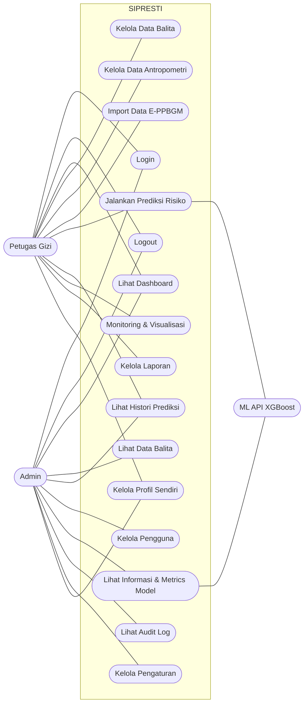
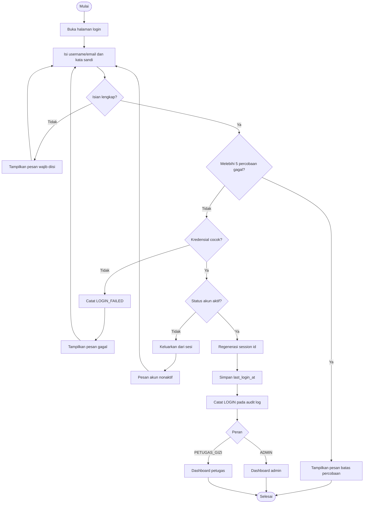
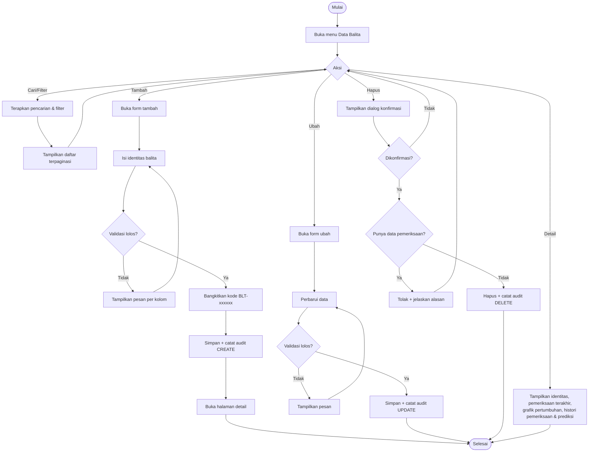
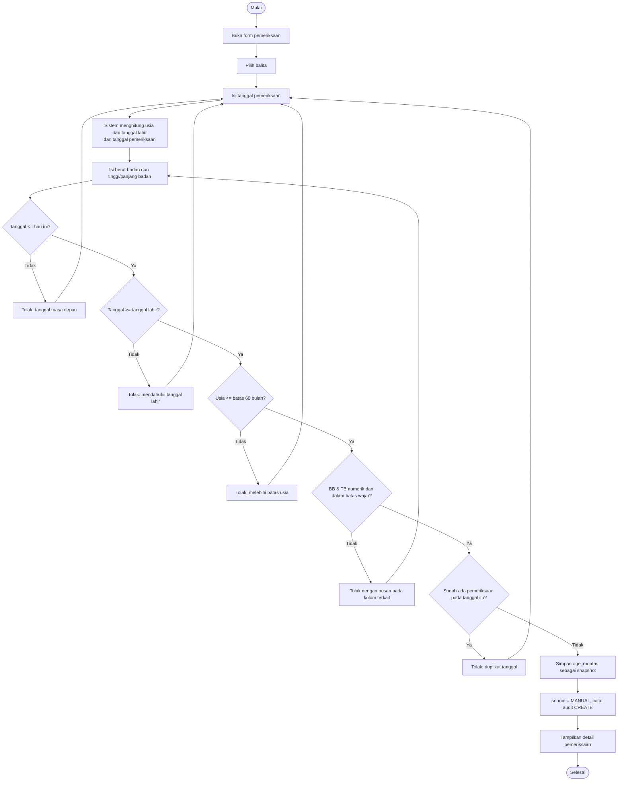
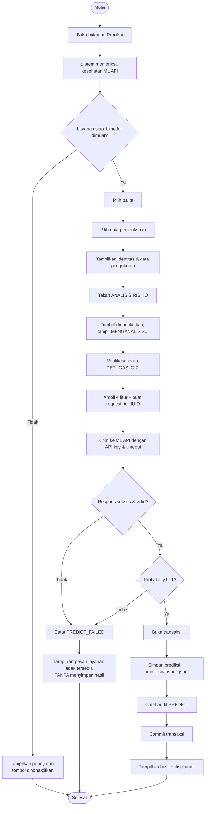
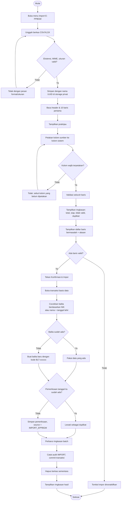
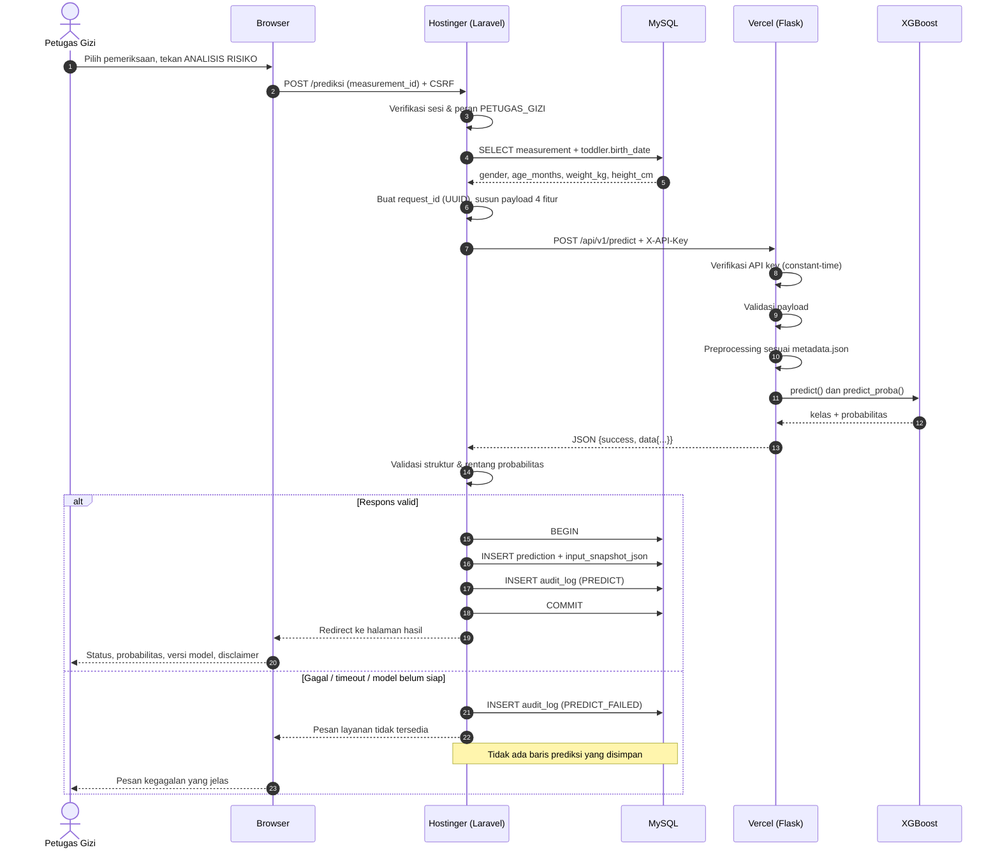
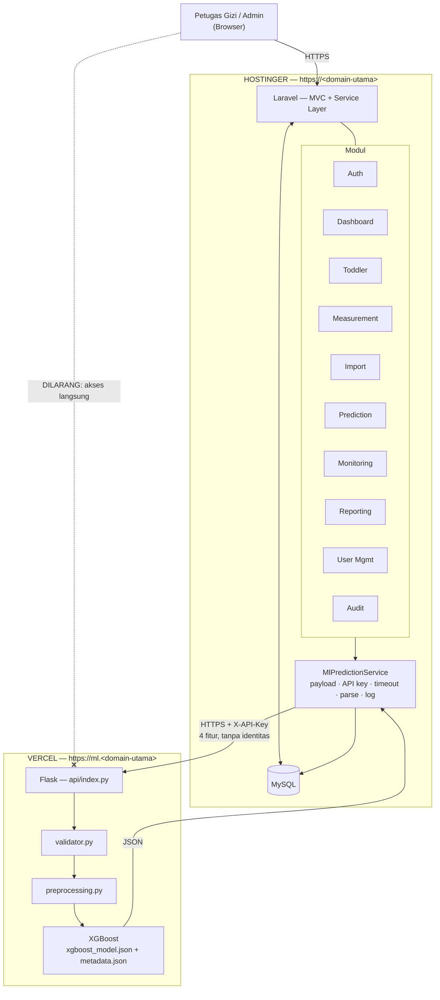
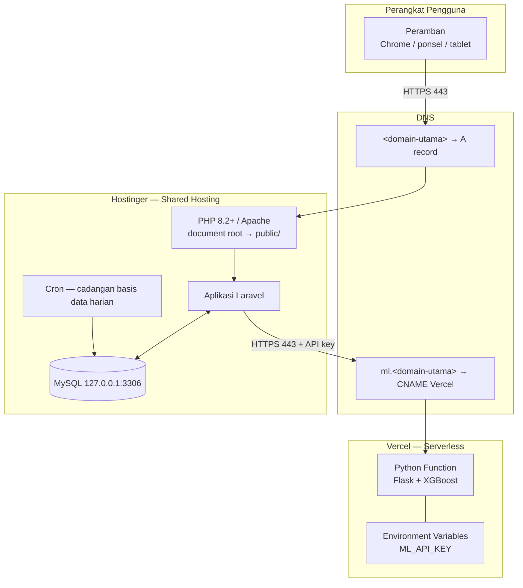
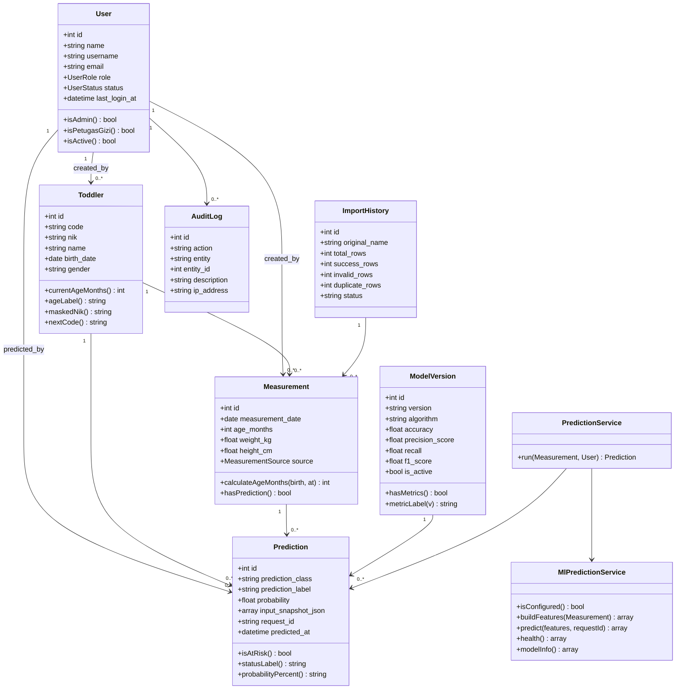

# Diagram Sistem

Semua diagram ditulis dengan Mermaid agar dapat diregenerate dan tetap sejalan
dengan kode. Bila alur pada kode berubah, perbarui diagram di berkas ini.

---

## 1. Use Case Diagram

### Identifikasi Aktor

| No | Aktor | Deskripsi |
|---|---|---|
| 1 | **Admin** | Memelihara sistem: pengguna, pengaturan, audit log, serta memantau informasi dan metrik model. Tidak memiliki hak tulis atas data klinis. |
| 2 | **Petugas Gizi** | Mengelola data balita dan antropometri dari E-PPBGM, menjalankan prediksi, memantau pertumbuhan, dan membuat laporan. |

### Identifikasi Use Case

| No | Use Case | Aktor | Rute |
|---|---|---|---|
| 1 | Login | Admin, Petugas Gizi | `GET/POST /login` |
| 2 | Logout | Admin, Petugas Gizi | `POST /logout` |
| 3 | Lihat Dashboard | Admin, Petugas Gizi | `GET /dashboard` |
| 4 | Kelola Data Balita | Petugas Gizi | `/balita` (CRUD) |
| 5 | Lihat Data Balita | Admin | `GET /balita`, `GET /balita/{id}` |
| 6 | Kelola Data Antropometri | Petugas Gizi | `/pemeriksaan` (CRUD) |
| 7 | Import Data E-PPBGM | Petugas Gizi | `/import` |
| 8 | Jalankan Prediksi Risiko | Petugas Gizi | `POST /prediksi` |
| 9 | Lihat Histori Prediksi | Admin, Petugas Gizi | `GET /prediksi` |
| 10 | Monitoring & Visualisasi | Petugas Gizi | `GET /monitoring` |
| 11 | Kelola Laporan | Petugas Gizi | `/laporan`, `/laporan/cetak`, `/laporan/ekspor` |
| 12 | Kelola Pengguna | Admin | `/admin/users` |
| 13 | Lihat Informasi & Metrics Model | Admin | `/admin/models`, `/admin/model-metrics` |
| 14 | Lihat Audit Log | Admin | `/admin/audit-logs` |
| 15 | Kelola Pengaturan | Admin | `/admin/settings` |
| 16 | Kelola Profil Sendiri | Admin, Petugas Gizi | `/profil` |

---

## 2. Activity Diagram — Login

---

## 3. Activity Diagram — Kelola Data Balita

---

## 4. Activity Diagram — Input Pemeriksaan

---

## 5. Activity Diagram — Prediksi Risiko

---

## 6. Activity Diagram — Import E-PPBGM

---

## 7. Sequence Diagram — Prediksi

---

## 8. Architecture Diagram

---

## 9. Deployment Diagram

---

## 10. Class Diagram (Model Domain)

